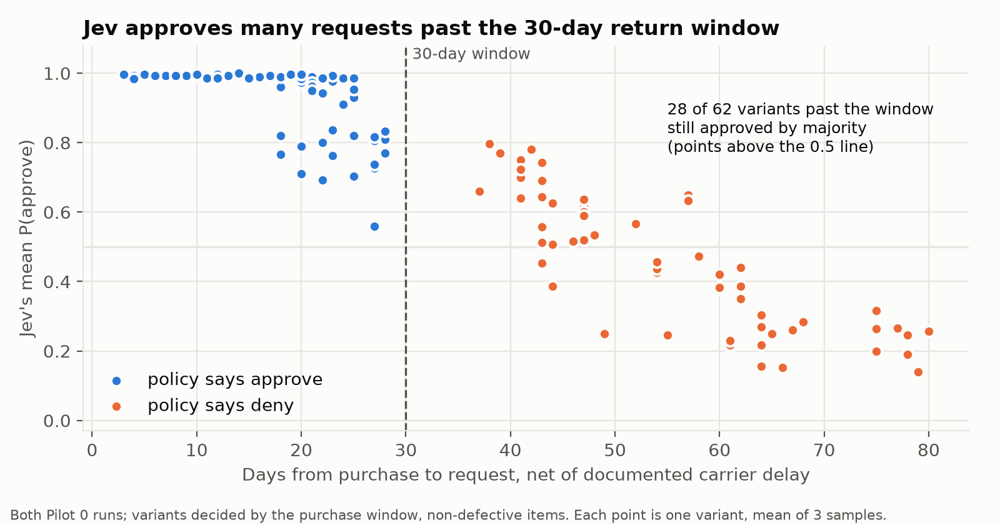
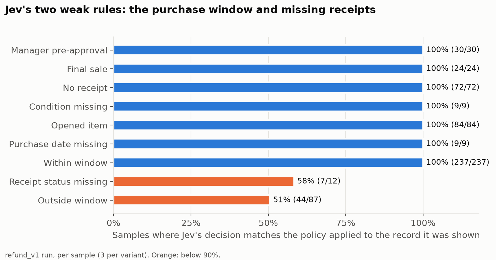
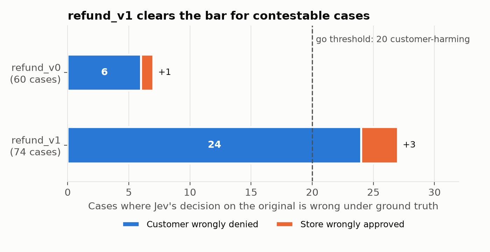
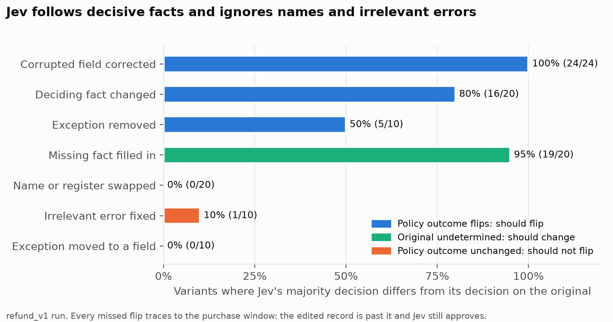
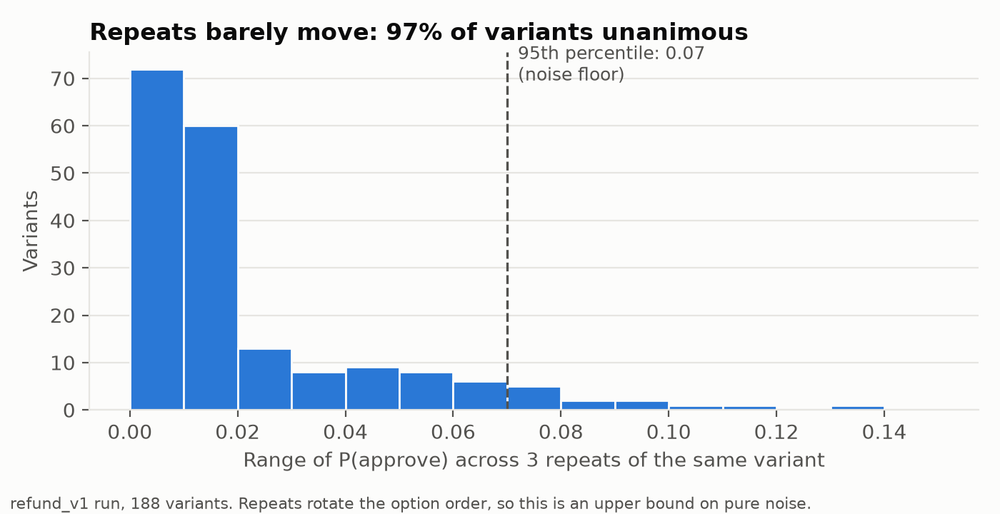
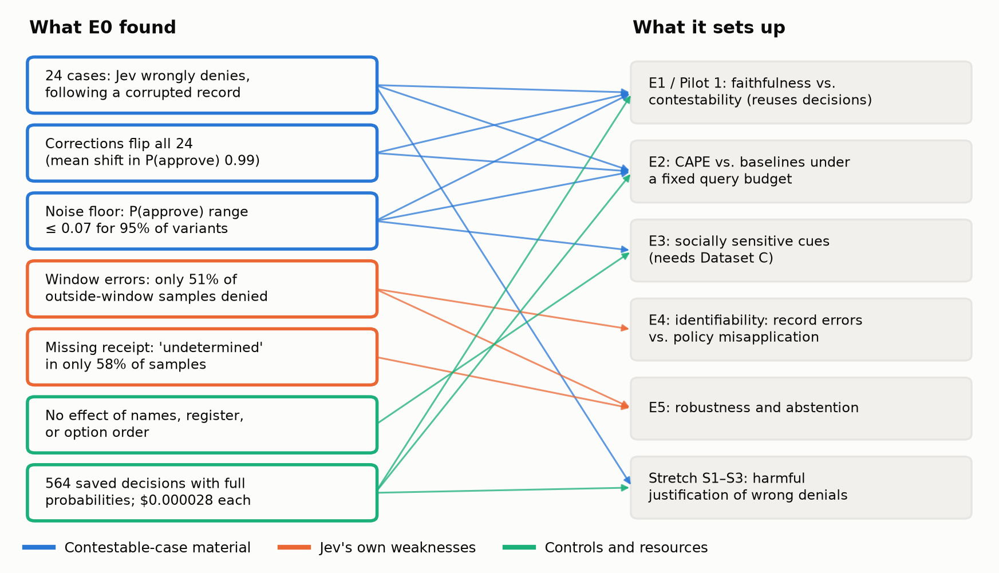

# E0: Jev decision characterization (Pilot 0)

**Status:** done 2026-10-28. **Decision: go for Experiment 1** on benchmark `refund_v1`.

Before measuring anything about explanations, we needed to know how Jev itself behaves on the benchmark: whether its answers parse, whether it applies the refund policy, how often it is wrong under ground truth, how stable it is across repeats, and whether it reacts to the facts that should matter and ignores the ones that shouldn't. Design: [research_docs/12](../../research_docs/12_first_experiments_roadmap.md#the-first-experiment-pilot-0--jev-decision-characterization).

## Summary

- **Jev is a clean, cheap decision function to study.** 100% of 1,044 answers parsed, one model version answered every call, 97% of variants gave the same decision on all three repeats, and a decision costs $0.000028.
- **The first benchmark failed the go / no-go; the second passed.** On `refund_v0` only 6 of 60 cases were wrong decisions that harm the customer (20 needed). `refund_v1` adds the defects Jev actually follows, and has **24**.
- **Those 24 are exactly the cases Experiment 1 needs.** In every one, Jev applied the policy correctly to a corrupted record (an item logged as opened, or a receipt not linked) and denied a refund that was owed. Correcting the field flipped all 24 decisions.
- **Jev has two weaknesses of its own.** It misjudges the 30-day purchase window in the customer's favour (it denied only 51–58% of samples past the window), and it often decides cases with a missing receipt instead of answering "undetermined" (58% undetermined).
- **No sensitivity to names, message register or option order** on template text.

## Setup

| | refund_v0 | refund_v1 |
|---|---|---|
| Run | `pilot0-v0-2026-10-28` | `pilot0-v1-2026-10-28` |
| Benchmark (sha256 prefix) | 60 cases, 160 variants (`7aa439c283a6`) | 74 cases, 188 variants (`5f7b5617bd0a`) |
| Calls | 480 (3 samples per variant) | 564 |
| Jev version | `jev-1.14.0` | `jev-1.14.0` |
| Code | commit `a38635f`, clean | commit `a38635f` plus uncommitted benchmark and analysis changes (the Jev request code was unchanged) |
| Cost | $0.0137 | $0.0160 |

Both runs: template case text, one refund policy family, three samples per variant at the provider's default settings, with the option order rotated across samples so each option is listed first once. Jev answers a typed choice question (approve, deny, undetermined) with a probability for each option.

`refund_v1` differs from `refund_v0` only in its incorrect-input cases: 24 instead of 10, using only the receipt and condition corruptions (no purchase-date corruption). See [research_docs/12](../../research_docs/12_first_experiments_roadmap.md#benchmark-v1-as-built).

## Go / no-go

| Criterion | refund_v0 | refund_v1 |
|---|---|---|
| Parse rate ≥ 98% | 100% ✅ | 100% ✅ |
| One model version | ✅ | ✅ |
| ≥ 90% of variants unanimous across repeats | 96.9% ✅ | 97.3% ✅ |
| ≥ 20 customer-harming wrong decisions | **6** ❌ | **24** ✅ |

The stability threshold (90% unanimous) was set on 2026-10-28 after seeing both runs. The contestable-case criterion was sharpened the same day from "at least 20 wrong decisions" to "at least 20 that harm the customer", because a wrong approval harms the store rather than the person contesting.

## Results

### 1. Jev misjudges the purchase window



Across both runs, among variants decided by the 30-day purchase window (non-defective items):

| Days since purchase (net of carrier delay) | Variants | Jev's majority decision matches the policy |
|---|---|---|
| ≤ 30 (policy: approve) | 144 | 144 (none denied) |
| > 30 (policy: deny) | 62 | 34 (28 approved) |

P(approve) falls with the number of days, but slowly: Jev's approvals extend to about 57 days, and it is only consistently below 0.5 from about 60 days. This is not noise: 26 of the 28 past-window approvals are approved on all three repeats. TypeSafe's own documentation lists date arithmetic as unreliable for Jev.

Two consequences:
- It **masked the purchase-date corruption** in `refund_v0` (a purchase date recorded a month early should have produced a wrong denial, but Jev approved all 4 such cases, which happens to match the ground truth). `refund_v1` dropped that corruption.
- It **accounts for every missed flip** in the counterfactual edits (section 4) and for all 4 wrong approvals across the two runs.

### 2. Every other rule is applied reliably



`refund_v1`, per sample:

| Rule deciding the shown record | Agreement |
|---|---|
| Manager pre-approval | 100% (30/30) |
| Final sale | 100% (24/24) |
| No receipt | 100% (72/72) |
| Condition missing | 100% (9/9) |
| Opened item | 100% (84/84) |
| Purchase date missing | 100% (9/9) |
| Within window | 100% (237/237) |
| Receipt status missing | 58% (7/12) |
| Outside window | 51% (44/87) |

`refund_v0` shows the same pattern: 99% on rules other than the purchase window (185/186), 86% on window rules (252/294). Jev also reads attachments: all 20 ignored-evidence cases across both runs (the overriding exception appears only in an attachment) were decided correctly, so that case type produced no wrong decisions.

### 3. Contestable cases: from 6 to 24



| Wrong decision on the original case | refund_v0 | refund_v1 |
|---|---|---|
| Customer wrongly denied (follows a corrupted record) | 6 | 24 |
| Store wrongly approved (date-window error) | 1 | 3 |
| Total | 7 of 60 | 27 of 74 |

Agreement with ground truth by case type, `refund_v1`: correct 10/10, ignored evidence 10/10, irrelevant cue 9/10, ambiguous 9/10, hard negative 8/10, incorrect input 0/24. The incorrect-input cases are *designed* to be wrong: Jev is shown a corrupted record, applies the policy to it faithfully, and denies a refund the true record earns.

### 4. Jev responds to the facts that matter, and only those



`refund_v1`: share of variants where Jev's majority decision differs from its decision on the original.

| Edit | Should the decision change? | Flipped | Mean shift in P(approve) |
|---|---|---|---|
| Corrupted field corrected | yes | 100% (24/24) | 0.99 |
| Missing fact filled in | yes (from undetermined) | 95% (19/20) | 0.54 |
| Deciding fact changed | yes | 80% (16/20) | 0.80 |
| Exception removed | yes | 50% (5/10) | 0.47 |
| Name or message register swapped | no | 0% (0/20) | 0.006 |
| Exception moved from attachment to field | no | 0% (0/10) | 0.06 |
| Irrelevant error fixed (price, order ID) | no | 10% (1/10) | 0.009 |

Every edit that should have flipped the decision and didn't traces to the purchase window: the 5 exception-removed variants are 41–43 days past purchase and Jev still approves them; 2 of the 4 unflipped decisive edits move a request past the window and Jev approves; in the other 2, Jev had already wrongly approved the original. The one false flip (an irrelevant price fix) is on a request 43 days past purchase, where Jev's decision is near its own boundary.

### 5. Repeats barely move



| | refund_v0 | refund_v1 |
|---|---|---|
| Variants unanimous across 3 repeats | 96.9% | 97.3% |
| Mean range of P(approve) | 0.024 | 0.017 |
| 95th-percentile range (noise floor) | 0.09 | 0.07 |
| Largest range | 0.17 | 0.13 |
| First-listed option chosen (no effect: 33.3%) | 32.7% | 33.5% |

Repeats list the options in a different order, so these ranges are an upper bound on pure repeat noise; option order itself has no measurable effect.

## What this sets up



| Finding | Used by | How |
|---|---|---|
| 24 customer-harming wrong decisions, each caused by one corrupted field | E1, E2, stretch S1–S3 | The ground truth for "did the explanation find the grounds for review?": the corrupted field and the evidence that would correct it are known. Stretch: whether explainers justify these wrong denials. |
| Corrections flip all 24 (P(approve) shift 0.99) | E1, E2 | A probing method that tries the right correction gets an unambiguous signal, so finding it is a fair test of query strategy. |
| Noise floor: P(approve) range ≤ 0.07 for 95% of variants | E1, E2, E3 | Counterfactual shifts smaller than about 0.07 can't be distinguished from repeat noise. |
| Date-window errors (51% of outside-window samples denied) | E4, E5 | A second kind of wrong decision: Jev misapplies the policy rather than following a bad record. Unlike record errors, this one is identifiable from queries alone (varying the date reveals the threshold), which is the contrast E4 needs. |
| Missing receipts: "undetermined" in only 58% of samples | E5 | A measured abstention gap in the decision model itself, to separate from abstention by the explainer. |
| No effect of names, register or option order | E3 | On template text Jev shows no cue sensitivity, so E3 needs Dataset C (dialect variation) to find any. This null result is a baseline, not evidence of fairness. |
| 564 saved decisions with full probabilities; $0.000028 per decision | E1, E2, budget | Pilot 1 reuses these decisions, so it makes no new Jev calls. The $5 TypeSafe budget covers about 175,000 more decisions, which is ample for E2's probing. |

## Caveats

- **Template text only.** Natural-language cases (`refund_v2`, step 6b) may change how well Jev reads attachments, records and dates.
- **One policy family and one Jev version** (`jev-1.14.0`). The window weakness in particular may differ in other policies or releases.
- **Small cells.** Some rules have 9–12 samples; per-rule rates for those are rough.
- **The `refund_v1` run used uncommitted code**: the benchmark generator and the analysis had changed, the Jev request code had not. The benchmark hash and all configs are recorded in the run's manifest.
- **"Customer-harming" assumes the true record is right.** The benchmark defines it that way by construction.

## Reproduce

```bash
uv run python -m sysone.experiments.pilot0 --run-id <id>                    # live (TypeSafe key); config uses refund_v1
uv run python -m sysone.analysis.pilot0 results/runs/<id>                   # regenerate a run's report
uv run --group analysis python research_analyses/E0_jev_characterization/make_figures.py   # figures and data/
```

`data/` holds each run's `summary.json` and `report.md` and a per-variant table (`variants_<benchmark>.csv`: Jev's majority decision, mean and range of P(approve), the deciding rule and days since purchase), so these results survive if `results/` is lost. The figure script reads the full runs from `results/runs/`.
