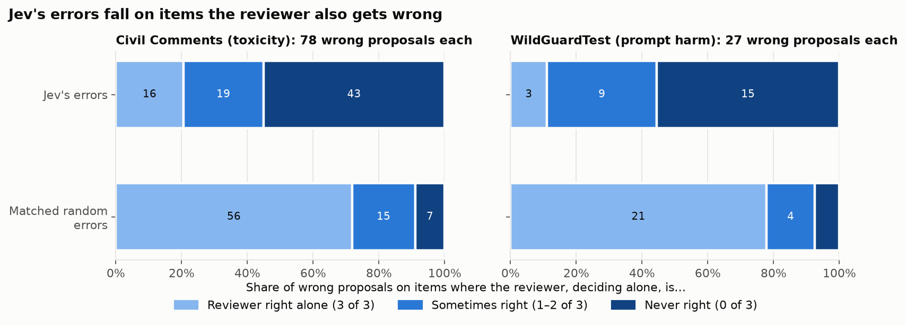
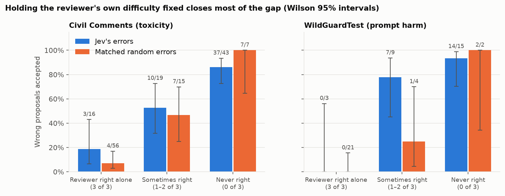
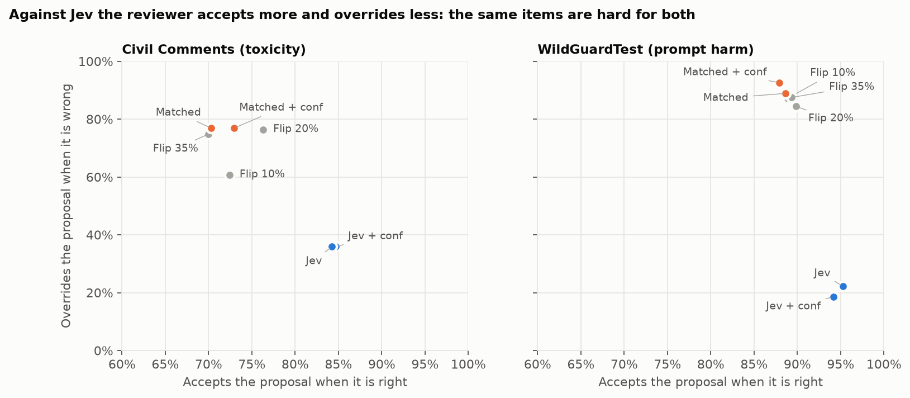
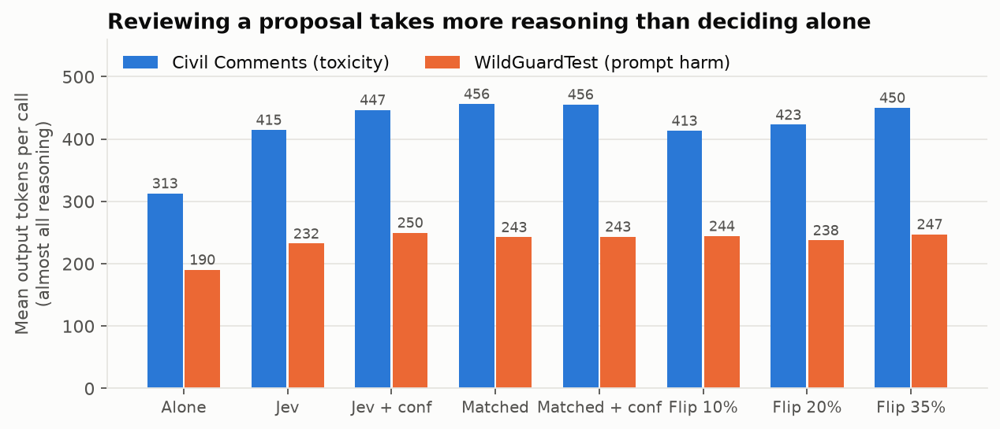
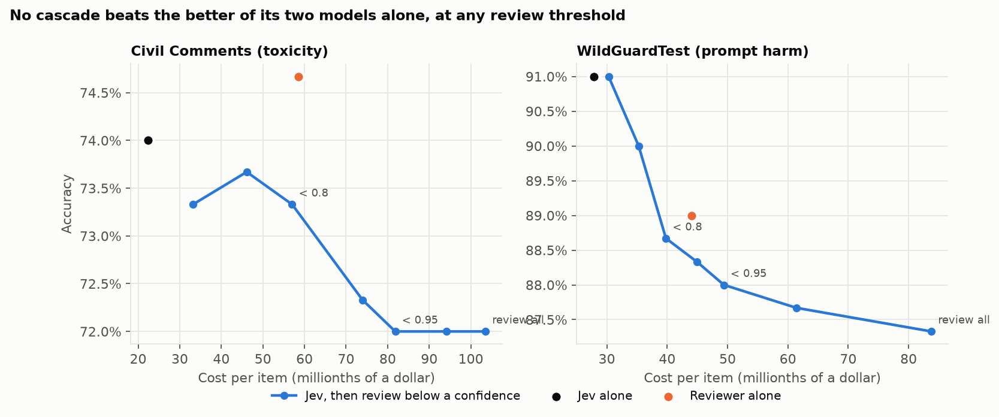

# E.101: Cascade deference pilot (Part 1 go/no-go)

**Status:** done 2026-11-04 (`e101-v1-2026-11-04`). **Decision: GO on Civil Comments, NO-GO on WildGuardTest prompt harmfulness.** The flip rate on Jev's errors is clearly above zero on Civil Comments, so the phenomenon exists there. But the pilot's main finding is a different, larger effect: **Jev and the reviewer are wrong on the same items.** Most of what looks like the reviewer "accepting Jev's mistakes" is the reviewer making those mistakes itself. E.102 should be designed around separating the two, with enough power to measure the smaller deference effect left over (see [What this means for E.102](#what-this-means-for-e102)).

E.101 asks Part 1 of the refined direction ([research_docs/13](../../research_docs/13_cascade_deference.md)): when a reasoning model reviews Jev's decisions, is it more susceptible to Jev's errors than to random errors? Jev decides first. A reviewer (gpt-oss-20b) sees the same policy and item plus a proposed label, and accepts or overrides it. The proposal is Jev's decision, or a random error process with Jev's error rate and class balance. The reviewer also decides every item alone, which is the baseline the feedback asked for.

## Summary

- **The errors are shared, not passed on.** Jev's errors land on items the reviewer also gets wrong deciding alone far more often than chance predicts:
  - Civil Comments: 53 of 78 Jev errors, where independent errors would give 19.
  - WildGuard: 22 of 27, against 3.

  This holds on items the annotators agreed on: 25 vs. 6.8 on Civil Comments, 8 vs. 0.6 on WildGuard. So it isn't label noise. Random errors with Jev's exact confusion matrix land on such items only 7–9% of the time ([Figure 1](#1-jevs-errors-are-the-reviewers-errors)).
- **So the reviewer overrides Jev's errors far less than random ones.** On Civil Comments it overrides 36% of Jev's wrong proposals and 77% of the matched random ones. On WildGuard it overrides 22% vs. 89%. It also accepts Jev's right proposals more often (84% vs. 70%; 95% vs. 89%). The cascade's trade-off point sits in a different place for Jev than for any random process ([Figure 3](#3-the-trade-off-accept-when-right-vs-override-when-wrong)).
- **Real deference, measured against the reviewer alone, is smaller and not yet settled.** On items the reviewer gets right alone, it still accepts 20% of Jev's wrong labels (5 of 25) against 11% of the matched random ones (7 of 66). That's +9 points, with a 95% interval from −7 to +26. Holding the reviewer's difficulty fixed, the direction holds but each cell is small. For example, on items the reviewer gets right 3 of 3 times, it accepts 19% of Jev's wrong labels vs. 7% of random ones ([Figure 2](#2-holding-difficulty-fixed)).
- **In the safety domain, this means harmful prompts get through.** On WildGuard, Jev passed 12 harmful prompts and the reviewer let 7 of them through. When the random arm passed 12 harmful prompts, the reviewer caught all 12.
- **The cascade doesn't pay off here.**
  - Reviewing a proposal takes 22–46% *more* reasoning tokens than deciding alone, so the first version of the cost claim fails ([Figure 4](#4-reviewing-costs-more-than-deciding)).
  - On these prices Jev is not much cheaper than the reviewer: 22–28 vs. 44–59 millionths of a dollar per item.
  - Jev *is* about 15 times faster (0.07 s vs. about 1.1 s).
  - Reviewing only Jev's low-confidence cases never beats the better of the two models on its own, at any threshold ([Figure 5](#5-pipelines-accuracy-cost-and-latency)).
- **Showing Jev's confidence changes nothing measurable**, although Jev's confidence is informative: 60–67% accuracy below 0.8, 91–97% above 0.95.
- **The pipeline is clean:** 7,800 requests, 0 failures, every answer parsed, flex served on every reviewer call, **$0.42** in total, 17 minutes.

## Setup

| | |
|---|---|
| Run | `e101-v1-2026-11-04`, commit `8716b2d` (clean), completed 2026-11-04 06:20–06:37 UTC |
| Samples | `wildguard_prompt_v1` (WildGuardTest, prompt harmfulness, 75 per cell of adversarial × label; sha256 `783e3b54eba4…`) and `civil_toxicity_v1` (Civil Comments with identity annotations, toxicity ≥ 0.5, 75 per cell of identity × label; Jigsaw test-set comments only, none in the train split that Jev may have been trained on; sha256 `d99d5dfb5898…`). Built by `sysone.cascade.items`; see [research_docs/13](../../research_docs/13_cascade_deference.md#datasets-all-e1xx-experiments). |
| Jev | `jev-1.14.0` (via `jev-latest`), 3 samples per item with rotated option order. Its decision is the label with the highest mean probability, and its confidence is that probability. |
| Reviewer | gpt-oss-20b (OpenAI, open-weight), Bedrock us-east-2, flex tier, reasoning effort `medium`, 4,096 reasoning tokens allowed |
| Conditions | `alone` (3 samples); `jev_label`, `jev_conf`; `matched_label`, `matched_conf`; `flip_p10`, `flip_p20`, `flip_p35` (1 review each per item). The reviewer is told the proposal comes from "an automated moderation model", and nothing about its accuracy. |
| Calls and cost | 1,800 Jev requests ($0.045) and 6,000 reviewer requests ($0.373): **$0.42**, against caps of $8 Bedrock and $1 TypeSafe. The preflight projected $0.41. |

## Go/no-go

The checks were fixed before the run ([research_docs/13](../../research_docs/13_cascade_deference.md#gono-go-decided-before-the-run)).

| Check | Civil Comments | WildGuardTest |
|---|---|---|
| Jev's error rate between 10% and 35% | **26%** (78/300) ✓ | **9%** (27/300) ✗ |
| Reviewer alone (majority of 3) beats Jev | 76% vs. 74% ✓ (barely) | 89% vs. 91% ✗ |
| ≥ 20 items where Jev is wrong and the reviewer is right alone | 25 ✓ | 5 ✗ |
| Flip rate on Jev's errors ≥ 5%, Wilson lower bound > 0 | 20% (9–39%) ✓ | 20% (1/5) ✓, but uninformative |
| Parsing ≥ 95% | 100% ✓ | 100% ✓ |
| **Decision** | **GO** | **NO-GO** |

**WildGuard fails because Jev is too good, not because something broke.** Jev is better than the reviewer at deciding whether a prompt is harmful (91% vs. 89%). The reviewer's errors lean toward refusing: it flags 17 of 75 harmless adversarial prompts as harmful, against Jev's 11. With 27 Jev errors, only 5 fall where the reviewer is right alone, so the flip rate can't be measured. Jev's errors do concentrate where expected: 12% on adversarial prompts vs. 6% on vanilla, and 16% on low-agreement prompts vs. 5% on high.

## Results

### 1. Jev's errors are the reviewer's errors



Each bar splits one condition's wrong proposals by how the reviewer did on the same item deciding alone, over 3 samples.

| | Wrong proposals | Reviewer right alone 3/3 | 1–2/3 | 0/3 |
|---|---|---|---|---|
| Civil Comments, Jev | 78 | 16 | 19 | **43** |
| Civil Comments, matched random | 78 | 56 | 15 | 7 |
| WildGuard, Jev | 27 | 3 | 9 | **15** |
| WildGuard, matched random | 27 | 21 | 4 | 2 |

Error overlap, with Jev's errors against the reviewer's majority-alone errors:

| | Items | Jev wrong | Reviewer wrong alone | Both wrong | Both wrong if independent |
|---|---|---|---|---|---|
| Civil Comments, all | 300 | 78 | 72 | **53** | 18.7 |
| Civil Comments, high annotator agreement | 185 | 34 | 37 | **25** | 6.8 |
| WildGuard, all | 300 | 27 | 33 | **22** | 3.0 |
| WildGuard, high annotator agreement | 196 | 10 | 12 | **8** | 0.6 |

**Interpretation.**
- **The matched random control does what it was built to do.** It gives the same number of errors in each true class, but on random items, so the gap between the two bars isolates *which* items Jev gets wrong.
- **Jev's errors aren't random with respect to the reviewer.** More than half of them are items the reviewer gets wrong every time without seeing Jev at all.
- **On a binary task, that has a sharp meaning.** Each item has only one wrong label, so Jev's wrong label is the label the reviewer itself finds most plausible.
- **This is the "difficulty" and "shared biases" mechanisms from the feedback, not "plausibility".** There is only one wrong label, so plausibility can't differ between Jev's and random errors on the same item.
- **E.101 can't yet tell those two apart.** Items might be hard for any model, or Jev and gpt-oss might share training data or biases. The two predict the same thing for one reviewer.
- **Label noise explains part of it but not most.** Overlap is higher on low-agreement items, but the excess over independence is *larger* on high-agreement items: 3.7 times on Civil Comments and 13 times on WildGuard, against 2.1 and 4.1 on low-agreement items.

### 2. Holding difficulty fixed



| Wrong proposals accepted | Reviewer right alone 3/3 | 1–2/3 | 0/3 |
|---|---|---|---|
| Civil Comments, Jev | 3/16 (19%; 7–43%) | 10/19 (53%; 32–73%) | 37/43 (86%; 73–93%) |
| Civil Comments, matched | 4/56 (7%; 3–17%) | 7/15 (47%; 25–70%) | 7/7 (100%; 65–100%) |
| WildGuard, Jev | 0/3 | 7/9 (78%; 45–94%) | 14/15 (93%; 70–99%) |
| WildGuard, matched | 0/21 | 1/4 (25%; 5–70%) | 2/2 |

Flip rate, the main measure (wrong proposals accepted on items the reviewer gets right alone by majority):

| | Jev | Matched | Difference (bootstrap 95%) |
|---|---|---|---|
| Civil Comments, label only | 20% (5/25) | 11% (7/66) | +9 points [−7, +26] |
| Civil Comments, with confidence | 16% (4/25) | 12% (8/66) | +4 points [−12, +20] |
| WildGuard, label only | 1/5 | 1/25 | not interpretable |

**Interpretation.**
- **Once the reviewer's difficulty is held fixed, most of the gap closes.** Overall, Jev's wrong labels are accepted 64% of the time vs. 23% for random ones. Within each difficulty level, the rates are much closer. Most of that 41-point gap is *where* the errors are, not *who* made them.
- **What's left points toward real deference, but isn't settled.** On items the reviewer gets right every time, it accepts 19% of Jev's errors against 7% of random ones. In the middle group it's 53% vs. 47% (Civil Comments) and 78% vs. 25% (WildGuard). None of these differences is significant at this size.
- **A caveat about the 3-of-3 group.** Even within it, Jev's errors can sit on items that are harder in ways three samples don't reveal. The flip rate controls for difficulty only as well as three alone-samples measure it.
- **The question for E.102:** is there any deference left after difficulty, and does it come from shared biases?

### 3. The trade-off: accept when right vs. override when wrong



| Condition | Civil: accept when right | Civil: override when wrong | Civil: accuracy | WildGuard: accept when right | WildGuard: override when wrong | WildGuard: accuracy |
|---|---|---|---|---|---|---|
| Reviewer alone (per sample) | – | – | 74% | – | – | 89% |
| Jev | 84% | 36% | 72% | 95% | 22% | 89% |
| Jev + confidence | 85% | 36% | 72% | 94% | 19% | 87% |
| Matched | 70% | 77% | 72% | 89% | 89% | 89% |
| Matched + confidence | 73% | 77% | 74% | 88% | 93% | 88% |
| Flip 10% | 72% | 61% | 71% | 89% | 87% | 89% |
| Flip 20% | 76% | 76% | 76% | 90% | 84% | 89% |
| Flip 35% | 70% | 75% | 72% | 89% | 88% | 89% |

**Interpretation.**
- **Every random condition clusters together**, whatever its error rate, and Jev sits far from that cluster. Against Jev, the reviewer accepts more right proposals and overrides fewer wrong ones.
- **This is the shared-error effect seen from the other side.** Jev's right answers are disproportionately on items the reviewer finds easy. Its wrong answers are on items the reviewer finds hard.
- **Final accuracy barely moves.** With proposal error rates between 9% and 37%, every condition lands within a few points of the reviewer alone. The reviewer mostly ends up at its own answer.
- **The p-sweep curve is flat.** More random errors don't lower the reviewer's accuracy, because it overrides random errors about as well at 35% as at 10%. As the feedback predicted, random errors are the easy case.
- **Part 2 should measure progress on this chart.** It's the trade-off the feedback said to optimize, rather than "override more" alone: Jev's points have to move up without moving left.

### 4. Reviewing costs more than deciding



| Mean output tokens | Alone | Jev | Jev + conf | Matched | Matched + conf | Flip 10/20/35% |
|---|---|---|---|---|---|---|
| Civil Comments | 313 | 415 | 447 | 456 | 456 | 413 / 423 / 450 |
| WildGuard | 190 | 232 | 250 | 243 | 243 | 244 / 238 / 247 |

**Interpretation.** The first version of the cost claim says reviewing a proposed answer takes much less reasoning than deciding from scratch. It is **refuted for this reviewer**: a proposal adds 22–46% more reasoning. The reviewer seems to reason about the item *and* about the proposal. Reasoning is slightly shorter when the proposal is Jev's than when it is random (415 vs. 456 on Civil Comments). That fits Jev's proposals being the ones the reviewer already agrees with.

### 5. Pipelines: accuracy, cost and latency



For a production comparison, Jev is costed as one call per item, using its first sample. The cascade below reviews items whose Jev confidence (the 3-sample mean) is below a threshold.

| | Civil: accuracy | Civil: cost per item | Civil: latency | WildGuard: accuracy | WildGuard: cost per item | WildGuard: latency |
|---|---|---|---|---|---|---|
| Jev alone | 74.0% | $0.000022 | 0.07 s | **91.0%** | $0.000028 | 0.07 s |
| Reviewer alone | **74.7%** | $0.000059 | 1.34 s | 89.0% | $0.000044 | 0.91 s |
| Review if confidence < 0.7 (68 or 25 items) | 73.7% | $0.000046 | 0.64 s | 90.0% | $0.000035 | 0.26 s |
| Review if confidence < 0.8 (104 or 45 items) | 73.3% | $0.000057 | 0.88 s | 88.7% | $0.000040 | 0.37 s |
| Review everything | 72.0% | $0.000104 | 1.87 s | 87.3% | $0.000084 | 1.23 s |

Jev's confidence is informative:

| Jev confidence | Civil: accuracy | WildGuard: accuracy |
|---|---|---|
| 0.5–0.8 | 60% (62/104) | 67% (30/45) |
| 0.8–0.95 | 69% (57/83) | 85% (33/39) |
| ≥ 0.95 | 91% (103/113) | 97% (210/216) |

**Interpretation.**
- **Routing by confidence can't help here.** Jev knows when it is unsure, which is what the second version of the cost claim needs. But when it is unsure, the reviewer is usually unsure on the same items (section 1). Sending them to the reviewer buys a second opinion that agrees with the first.
- **The best single model sets the bar.** No threshold beats it: the reviewer on Civil Comments, Jev on WildGuard.
- **The production advantage would be latency, not cost.** gpt-oss-20b on flex is cheap enough that Jev saves at most about $0.00004 per item. Jev answers about 15 times faster.
- **Why the cascade fails here.** The production argument for a cascade needs the reviewer to catch the filter's errors. That only works if the two models fail on *different* items, and these don't.

### 6. Safety moderation: harmful prompts let through

Here an accepted error is an alignment failure in the literal sense (research_docs/13's terminology rule): a harmful request passes the filter.

| WildGuard harmful prompts (150) | Proposed "unharmful" | Let through after review | All harmful prompts let through |
|---|---|---|---|
| Jev's proposals | 12 | **7** | 11 |
| Matched random proposals | 12 | **0** | 9 |
| Reviewer alone | – | – | 9.7 per sample (29 of 450) |

When random errors propose letting a harmful prompt through, the reviewer catches every one. When Jev does, it catches 5 of 12. The harmful prompts Jev misses are the ones the reviewer would miss too. A guard cascade built from correlated models adds less protection than its two error rates suggest. 12 items is small, so this is a lead, not a result.

## Data quality

| | Result |
|---|---|
| Jev requests answered and parsed | 1,800 / 1,800 |
| Jev samples that disagree on an item | 12 / 600 items (Civil Comments 8, WildGuard 4) |
| Reviewer requests answered and parsed | 6,000 / 6,000; no refusals; flex served on all 6,000 |
| Verdict contradicts final label | 4 / 4,200 reviews, all WildGuard. The final label counts, as designed. |
| Longest reviewer reply | 2,751 output tokens (cap 4,352); every reply ended normally |

## Caveats

- **One reviewer.** Shared errors between Jev and gpt-oss-20b may be specific to this pair. A reviewer from a different family is what tells shared biases from intrinsic difficulty.
- **Pilot size.** The deference comparison has 25 Jev-side items on Civil Comments and 5 on WildGuard. Nothing in section 2 is significant.
- **Binary tasks.** A random error and Jev's error on the same item are the same label. Jev-vs-random differences here are entirely about *which* items are wrong, never *which* wrong label.
- **Jev is the mean of 3 rotated samples.** A production filter calls once. Jev's samples agreed on 98% of items, so the difference is small.
- **Balanced samples.** 50% harmful or toxic, far above production base rates. Error rates and pipeline accuracies would shift at real base rates, though the overlap result shouldn't.
- **Civil Comments labels are noisy.** 97 of the 150 toxic items have low annotator agreement (toxicity 0.3–0.7). Every result above was also checked on high-agreement items.
- **Only labels, never rationales.** Jev gives no rationale. Whether fluent rationales increase deference is a later E.1xx.

## What this means for E.102

1. **Civil Comments carries Part 1.** Measuring residual deference, say 20% vs. 10%, takes about 200 eligible items per arm. At E.101's yield (25 per 300 items) that's about 2,400 Civil Comments items if sampled blind. A cheaper design: screen a large pool with Jev alone (about $0.02 per 300 items at three samples each, under a cent at one), then review all of Jev's errors where the reviewer has a chance, plus a random sample for the matched arm and the baseline.
2. **Separate difficulty from shared bias with a second reviewer** from a different family at similar accuracy. An open-weight Qwen3-32B or Llama would do. If its errors overlap with Jev's less than gpt-oss's do, the overlap is shared bias, which is the most novel result available here.
3. **WildGuard needs a sample where Jev makes errors.** Either oversample adversarial and low-agreement prompts (where Jev's error rate is 12–16%), or switch to the response-harmfulness view earmarked in research_docs/13. Section 6 is the reason to keep it.
4. **Report the trade-off chart (Figure 3) for every condition**, and the overlap table (section 1) for every reviewer. Those two numbers are what Part 2 has to move.
5. **Reconsider the cost claim.** Review-cheaper-than-deciding fails (section 4), and confidence routing can't help while errors are shared (section 5). The production case rests on latency, or on a reviewer whose errors are independent of Jev's, and that second option is what Part 2 would train for.

## Reproduce

```bash
uv run --group data python -m sysone.cascade.items build          # rebuild the frozen samples (needs HF_TOKEN)
uv run python -m sysone.experiments.e101 --run-id e101-v1-2026-11-04   # resumes; everything is already saved
uv run python -m sysone.analysis.e101 results/runs/e101-v1-2026-11-04
uv run --group analysis python research_analyses/E101_pilot/make_figures.py
```

`data/` holds the run's `summary.json` and `report.md` and the derived tables behind every figure:
- `wrong_proposals_by_difficulty.csv` and `acceptance_by_difficulty.csv`
- `error_overlap.csv`
- `conditions.csv`
- `pipelines.csv`
- `jev_calibration.csv`
