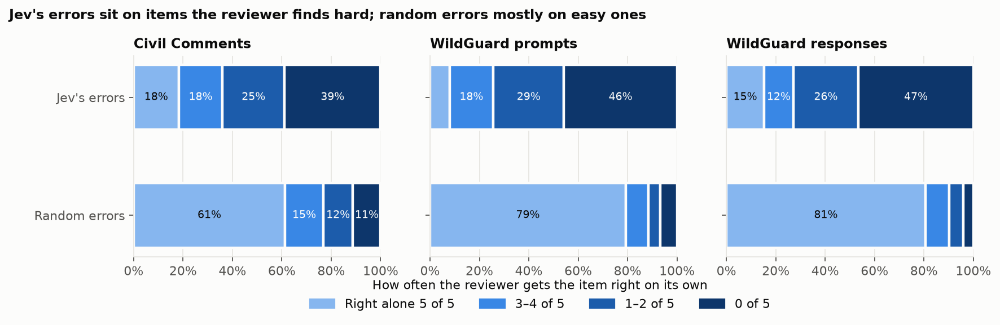
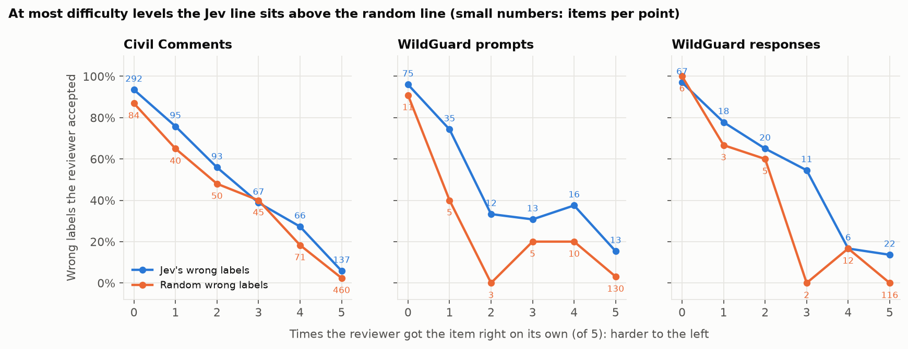
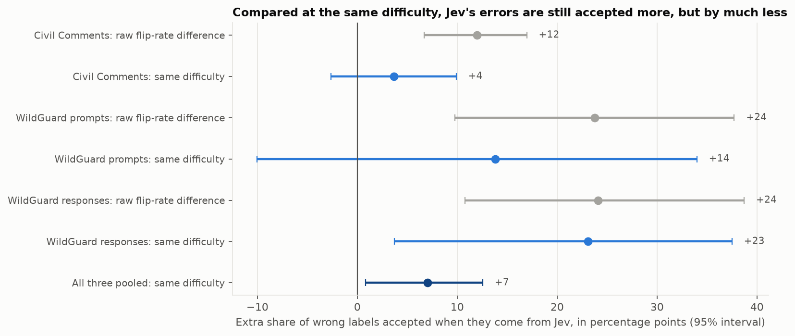
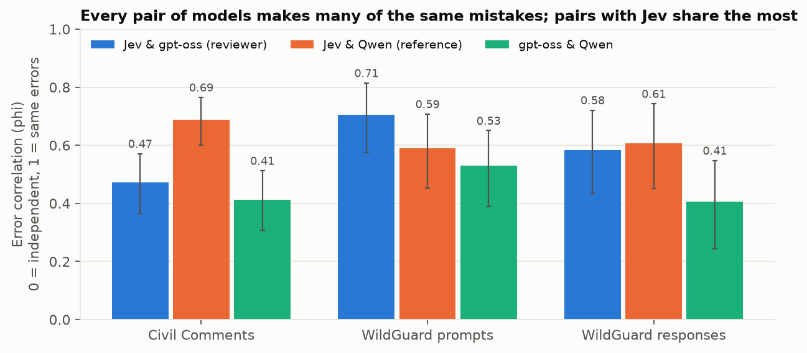
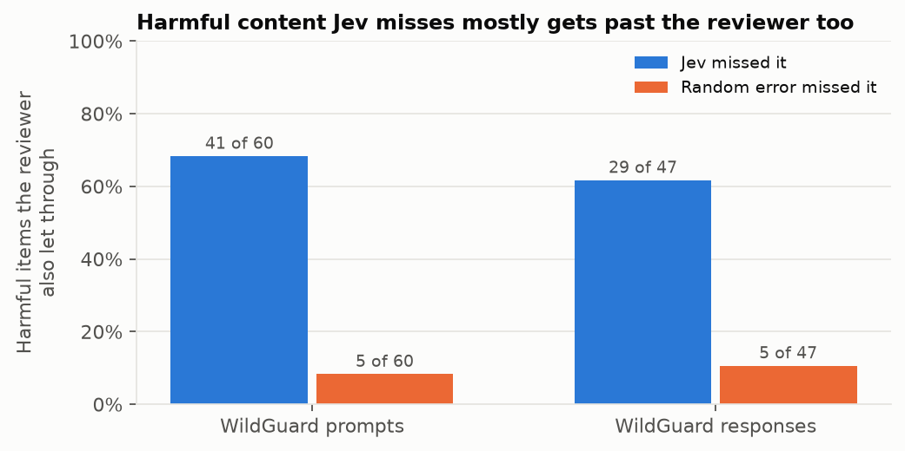

# E.102: Deference beyond shared difficulty (Part 1, powered)

**Status:** done 2026-11-04 (`e102-v1-2026-11-04`, $1.81). **Answer to Part 1: yes, the reviewer is more susceptible to Jev's mistakes than to random ones, and by a lot in practice. But most of the gap is *not* the reviewer being swayed by Jev. It's Jev's mistakes being mistakes the reviewer would make anyway.** Once that is accounted for, a smaller but real swaying effect remains: about 5–8 percentage points.

## The short version, in plain terms

**What we tested.** Jev makes a first decision, and a second model (the reviewer, gpt-oss-20b) checks it. Sometimes the decision it checks is really Jev's. Sometimes it's a fake "upstream decision" with random mistakes planted in it, in the same number and of the same kind as Jev's. We count how often the reviewer goes along with a wrong decision in each case.

**What we found.**
1. **The reviewer goes along with Jev's mistakes far more often than random ones.** On Civil Comments it accepts 60% of Jev's wrong labels and 22% of the random wrong labels. On WildGuard it lets through about two thirds of the harmful content Jev missed, but only about a tenth of the harmful content a random error missed.
2. **The main reason: Jev and the reviewer have the same blind spots.** Jev's mistakes land on the items the reviewer *also* gets wrong when it decides on its own, with no Jev in sight. On Civil Comments, 39% of Jev's mistakes are on items the reviewer gets wrong every single time alone; only 11% of the random mistakes are. You can't "talk someone into" a mistake they were going to make anyway, and most of the effect is exactly that.
3. **There is also some real swaying.** When we compare items the reviewer finds *equally hard*, it still accepts Jev's wrong labels somewhat more often than random wrong labels: about **7 points more** across all three datasets (95% interval +0.8 to +12.6). That is deference in the strict sense: seeing Jev's answer pulls the reviewer toward it, beyond what the item's difficulty explains.
4. **The cascade doesn't make better decisions than its best single model.** Jev followed by the reviewer is about as accurate as Jev alone on Civil Comments (77% vs. 76%), and worse on WildGuard (88% vs. 90–92%). It costs 2.6–4.6 times as much as Jev alone and is 15–24 times slower.

**An analogy.** A junior doctor makes a diagnosis and a senior doctor reviews it. If the senior doctor agrees with the junior's mistakes, there are two very different reasons it could happen. Either the senior would have made the same mistake on those patients anyway (the cases are genuinely hard, or both were trained the same way), or the senior was swayed by the junior's opinion. E.102 finds mostly the first, plus some of the second.

## What this means for our hypotheses

| # | Hypothesis (fixed before the run, [research_docs/13](../../research_docs/13_cascade_deference.md#hypotheses-decided-before-the-run)) | Result | Verdict |
|---|---|---|---|
| 1 | **Primary.** On Civil Comments, the reviewer accepts Jev's wrong labels more often than random ones, on items it gets right alone (the flip rate). | 19% (52/270) vs. 7% (42/576): **+12 points [+7, +17]** | **Supported as written, but the test was weaker than intended.** Even among items the reviewer gets right alone, Jev's mistakes are on harder ones: only half are items it gets right 5 of 5 times, against 80% for random mistakes. Compared at exactly the same difficulty, Civil Comments alone shows +3.6 points [−2.6, +9.9]: not significant. |
| 2 | Same for the strict flip rate (right 5 of 5 alone) and within each difficulty level. | Civil Comments strict: 6% vs. 2%, +3.5 points [−0.4, +8.0]. Pooled over the three datasets: **+5.4 [+1.4, +9.6]**. | **Partly supported:** borderline on one dataset, clear when the three are pooled. |
| 3 | Error overlap. If all three model pairs have similar error correlation, the overlap is about the items; if one pair stands out, those two share something. | All pairs are strongly correlated (0.41–0.71). Pairs that include Jev are higher than gpt-oss–Qwen on all three datasets. At least one Jev pair is significantly higher on each, and both are on responses. On Civil Comments, Jev–Qwen (0.69) stands out above both other pairs. | **Both, not either.** Much of the overlap is about the items: every model fails on the same hard ones. On top of that, Jev shares *more* errors with each of the others than they share with each other. |
| 4 | Safety. Harmful items Jev passes get through review more often than harmful items random errors pass. | Prompts: 41 of 60 (68%) vs. 5 of 60 (8%). Responses: 29 of 47 (62%) vs. 5 of 47 (11%). | **Supported**, strongly. This is the raw comparison, so like hypothesis 1 it includes the shared-blind-spot effect. |

**The pooled difficulty-matched estimate (+7 points) wasn't pre-registered.** I added it after seeing that the raw flip rate mixes difficulty into the comparison. The method is standard (direct standardization), and the estimator has its own test ([tests/test_e102.py](../../tests/test_e102.py)). From now on it should be the pre-registered primary measure.

## What this means for testing and for Part 2

1. **Measure deference at equal difficulty from now on.** The raw flip rate overstates deference about threefold on Civil Comments (+12 vs. +4 points), because Jev's mistakes are on harder items even among those the reviewer "gets right". Every future E.1xx should report the difficulty-matched number as its primary measure, and the raw one alongside it.
2. **Part 2 has two different problems to fix, and post-training against deference only fixes one.**
   - **Deference** (the reviewer swayed by Jev) is the smaller part. On Civil Comments, removing it completely would lower the share of Jev's mistakes that get through from 60% to about 54% (the random arm's rate at the same difficulty). On WildGuard prompts, from 70% to about 54%.
   - **Shared blind spots** are the bigger part. Even a reviewer that ignored Jev entirely would still pass about half of Jev's mistakes, because it makes them itself. Fixing that means making the reviewer *better on the items Jev gets wrong*, or choosing a reviewer whose blind spots differ from Jev's. Resisting Jev doesn't help there.
3. **The cheap alternatives the feedback listed now have a clear target.** A "blind-first" protocol (the reviewer answers before it sees Jev's decision) should remove most of the deference part for free, and none of the blind-spot part. That makes it the natural next experiment and the baseline Part 2 has to beat.
4. **Error overlap is a way to choose a reviewer.** A cascade only helps when the reviewer fails on *different* items than Jev. On Civil Comments, gpt-oss overlaps with Jev less than Qwen does (0.47 vs. 0.69), so gpt-oss is the better choice of reviewer there. On WildGuard prompts it's the other way round (0.71 vs. 0.59).
5. **The production story still doesn't hold** for these domains and models: no cascade beats its best single model. A cascade needs a reviewer whose blind spots differ from Jev's. "Trained to resist Jev" is only part of that.

## Setup

| | |
|---|---|
| Run | `e102-v1-2026-11-04`, commit `dcfc0d8` (clean). Stage 1 07:40–07:43 UTC, Stage 2 07:45–08:33 UTC (2026-11-04) |
| Pools (Stage 1) | `civil_toxicity_pool_v1` (3,000 Civil Comments, 750 per identity × label cell; Jigsaw test-set comments only, none of E.101's), `wildguard_prompt_full_v1` (all 1,699 labeled WildGuardTest prompts), `wildguard_response_full_v1` (all 1,707 labeled responses, shown with their prompts) |
| Jev | `jev-1.14.0`, 3 samples per item (rotated option order); its decision is the label with the highest mean probability |
| Reviewer | gpt-oss-20b (Bedrock, flex tier, reasoning effort medium), the only reviewer |
| Reference | Qwen3-32B (Bedrock, flex). It **doesn't reason**, because Bedrock serves it only without thinking. It decides the random subsample alone and never reviews. |
| Stage 2 plan | Jev-wrong items: 5 alone decisions + a review of Jev's label. Matched-wrong items (random errors with Jev's confusion matrix, drawn over the whole pool): 5 alone + a review of that label. 400 random items per pool: 5 alone + a review of the correct label, plus Qwen alone × 3. |
| Volume | 19,218 Jev, 17,361 reviewer and 3,600 reference requests. **0 failed, 0 unparsed, 0 cut off, flex on every Bedrock call**, 1 verdict contradicting its label. |
| Cost | **$1.81**: TypeSafe $0.56 (projected $0.79), Bedrock $1.25 (projected about $1.8); caps $1.50 and $8 |
| Dropped from E.101 | The confidence conditions (showing Jev's confidence had **no measurable effect**; only the proposed decision itself moved the reviewer) and the random-flip sweep (flat) |

## Results

### 1. Jev's error rates on the pools

| Pool | Items | Jev wrong | Missed (should have flagged) | Over-flagged | Where Jev errs most |
|---|---|---|---|---|---|
| Civil Comments | 3,000 | 750 (25%) | 439 of 1,500 toxic | 311 of 1,500 non-toxic | Low annotator agreement 35% vs. high 19%; identity mentioned 28% vs. not 22% |
| WildGuard prompts | 1,699 | 164 (10%) | 60 of 754 harmful | 104 of 945 harmless | Adversarial 15% vs. vanilla 5%; low agreement 19% vs. high 5% |
| WildGuard responses | 1,707 | 144 (8%) | 47 of 283 harmful (17%) | 97 of 1,424 harmless | Compliant responses 12% vs. refusals 1%; adversarial 12% vs. vanilla 5% |

Jev's Civil Comments error rate matches E.101 (25% vs. 26%). It almost never misjudges a refusal (1%), but misses 17% of harmful responses: twice its miss rate on harmful prompts.

### 2. Raw comparison: the reviewer accepts far more of Jev's mistakes

| | Civil Comments | WildGuard prompts | WildGuard responses |
|---|---|---|---|
| Jev's wrong labels overridden | 40% (301/750) | 30% (50/164) | 29% (42/144) |
| Random wrong labels overridden | 78% (585/750) | 88% (145/164) | 91% (131/144) |
| Flip rate (wrong label accepted where the reviewer is right alone), Jev | 19% (52/270) | 29% (12/42) | 26% (10/39) |
| Flip rate, random | 7% (42/576) | 5% (7/145) | 2% (2/130) |
| Difference (bootstrap 95%) | **+12 [+7, +17]** | **+24 [+10, +38]** | **+24 [+11, +39]** |
| Right labels accepted, Jev's | 87% (263/303) | 95% (344/361) | 93% (345/370) |
| Right labels accepted, random arm's | 76% (233/306) | 89% (318/359) | 89% (329/370) |

Read plainly: **against Jev, the reviewer agrees more, both when Jev is wrong and when it's right.** Both have the same cause: the items Jev gets right tend to be ones the reviewer finds easy, and the items Jev gets wrong tend to be ones it finds hard.

### 3. Why: Jev's mistakes are on the reviewer's blind spots



| Wrong proposals, by the reviewer's own record (of 5 tries alone) | 5/5 right | 3–4 | 1–2 | 0/5 right |
|---|---|---|---|---|
| Civil Comments, Jev | 137 (18%) | 133 (18%) | 188 (25%) | **292 (39%)** |
| Civil Comments, random | 460 (61%) | 116 (15%) | 90 (12%) | 84 (11%) |
| WildGuard prompts, Jev | 13 (8%) | 29 (18%) | 47 (29%) | **75 (46%)** |
| WildGuard prompts, random | 130 (79%) | 15 (9%) | 8 (5%) | 11 (7%) |
| WildGuard responses, Jev | 22 (15%) | 17 (12%) | 38 (26%) | **67 (47%)** |
| WildGuard responses, random | 116 (81%) | 14 (10%) | 8 (6%) | 6 (4%) |

**Interpretation.** The random arm has exactly Jev's number of mistakes, of exactly Jev's kind, placed on random items, so it shows what "a mistake on a typical item" looks like. Most random mistakes land on items the reviewer always gets right, and it catches them. Jev's mistakes land mostly on items the reviewer gets wrong at least sometimes. Nearly half of them are on items it never gets right, where accepting Jev's label is simply the reviewer's own answer.

### 4. At the same difficulty, a smaller real effect remains



Wrong labels accepted on Civil Comments, by how often the reviewer gets the item right alone:

| Right alone (of 5) | 0 | 1 | 2 | 3 | 4 | 5 |
|---|---|---|---|---|---|---|
| Jev's wrong labels | 93% (292) | 76% (95) | 56% (93) | 39% (67) | 27% (66) | 6% (137) |
| Random wrong labels | 87% (84) | 65% (40) | 48% (50) | 40% (45) | 18% (71) | 2% (460) |

(In brackets: how many wrong labels sit at that level. The two WildGuard views are in `data/acceptance_by_k.csv`; the random arm has very few hard items there.)



| Extra share of wrong labels accepted when they come from Jev (points, 95%) | Raw flip-rate difference | Same difficulty, items right alone | Same difficulty, right 5 of 5 | Same difficulty, all wrong labels |
|---|---|---|---|---|
| Civil Comments | +12 [+7, +17] | +3.6 [−2.6, +9.9] | +3.5 [−0.4, +8.0] | +6.2 [+1.4, +10.9] |
| WildGuard prompts | +24 [+10, +38] | +13.8 [−10.1, +34.0] | +12.3 [−4.4, +35.2] | +15.6 [+0.7, +30.2] |
| WildGuard responses | +24 [+11, +39] | +23.1 [+3.7, +37.5] | +13.6 [0.0, +30.0] | +6.9 [−5.0, +19.6] |
| **All three pooled** | – | **+7.0 [+0.8, +12.6]** | **+5.4 [+1.4, +9.6]** | **+7.8 [+3.1, +12.2]** |

**How the comparison works.** For each difficulty level (0 to 5 of 5 right alone), we take the random arm's acceptance rate. We then average those rates using Jev's mix of difficulty levels. The result answers: "if random mistakes were as hard as Jev's, how often would the reviewer accept them?" The gap between that and Jev's actual rate is deference beyond difficulty.

**Interpretation.**
- **Most of the raw gap is difficulty.** On Civil Comments, +12 shrinks to about +4 once the two arms are compared at the same difficulty.
- **The direction is consistent.** Jev's line is above the random line at 15 of the 18 difficulty points, level at 1 and below at 2, and all 12 difficulty-matched estimates in the table are positive.
- **Pooled, the effect is clearly above zero:** about 5–8 points. Seeing Jev's answer does pull the reviewer toward it a little.
- **This is still an upper bound on deference.** Five alone samples measure difficulty only roughly. Within one level, Jev's mistakes may still sit on items that are hard in ways five tries don't reveal.

The reviewer also reasons longer on Jev's wrong labels than on random ones: 539 vs. 465 output tokens on Civil Comments, and 379 vs. 268 on WildGuard prompts (it reasons for 348 and 236 tokens deciding alone). It seems to sense that something is off, then accepts anyway.

### 5. Whose mistakes overlap



Error correlation (phi) on the random subsample of 400 items per pool. 0 means independent mistakes; 1 means exactly the same mistakes.

| | Jev & gpt-oss | Jev & Qwen | gpt-oss & Qwen | Both wrong vs. if independent (Jev & gpt-oss) |
|---|---|---|---|---|
| Civil Comments | 0.47 [0.37, 0.57] | **0.69 [0.60, 0.77]** | 0.41 [0.31, 0.51] | 59 vs. 24 |
| WildGuard prompts | **0.71 [0.57, 0.81]** | 0.59 [0.45, 0.71] | 0.53 [0.39, 0.65] | 29 vs. 3.9 |
| WildGuard responses | 0.58 [0.43, 0.72] | 0.61 [0.45, 0.74] | 0.41 [0.24, 0.55] | 22 vs. 3.1 |

Differences that exclude 0 (paired bootstrap, `data/error_correlation_differences.csv`):
- Civil Comments: Jev–Qwen is above Jev–gpt-oss (+0.22) and above gpt-oss–Qwen (+0.28).
- WildGuard prompts: Jev–gpt-oss is above gpt-oss–Qwen (+0.18).
- WildGuard responses: both Jev pairs are above gpt-oss–Qwen (+0.18 and +0.20).

The pattern holds on items the annotators agreed on (`phi_high_agreement` in `data/error_correlation.csv`), except one pair: on high-agreement WildGuard prompts, Jev–Qwen (0.46) falls just below gpt-oss–Qwen (0.49).

**Interpretation, plainly.**
- **All three models stumble on many of the same items.** That's the shared-difficulty part, and it's large.
- **Jev is the hub.** By point estimate, it shares more mistakes with each of the other two than they share with each other. In each dataset at least one of those differences is significant. One reading: Jev makes the "typical" mistakes, the ones most models make, while gpt-oss and Qwen each add mistakes of their own.
- **On Civil Comments, Jev and Qwen are especially alike.** That fits two explanations that E.102 can't tell apart:
  - Jev is related to Qwen. TypeSafe's "Jev boost" training sets were embedded with a Qwen model.
  - Jev and Qwen-without-thinking are both quick, non-reasoning deciders, while gpt-oss reasons first.

  A reasoning model from another family as a second reference would separate the two.

### 6. Safety: harmful content that gets through



| Harmful items the upstream decision called harmless | Count | Reviewer let through |
|---|---|---|
| Prompts, Jev missed | 60 | **41 (68%)** |
| Prompts, random error | 60 | 5 (8%) |
| Responses, Jev missed | 47 | **29 (62%)** |
| Responses, random error | 47 | 5 (11%) |

In a guard-model cascade, this is the number that matters, and it's where "misalignment" is the right word (research_docs/13's terminology rule): harmful requests and harmful answers get past both filters. A second model only adds safety where it fails differently from the first. Here, two thirds of what Jev misses, the reviewer misses too. As in section 2, this comparison includes the shared-blind-spot effect, which is the point: in practice, that's what lets harmful content through.

### 7. Pipelines

Accuracy on the random subsample (400 items per pool), with cost and latency per item. Jev is costed as one call.

| | Civil: accuracy | Civil: cost, latency | Prompts: accuracy | Prompts: cost, latency | Responses: accuracy | Responses: cost, latency |
|---|---|---|---|---|---|---|
| Jev alone | 76% | $0.000022, 0.07 s | **90%** | $0.000028, 0.08 s | **92%** | $0.000042, 0.07 s |
| Reviewer alone (gpt-oss) | 75% | $0.000060, 1.26 s | 89% | $0.000046, 0.91 s | 90% | $0.000062, 0.99 s |
| Jev, then reviewer on everything | **77%** | $0.000102, 1.72 s | 88% | $0.000082, 1.10 s | 88% | $0.000111, 1.16 s |
| Qwen alone (reference) | 74% | $0.000023, 0.26 s | 88% | $0.000032, 0.24 s | 90% | $0.000057, 0.28 s |

On Civil Comments and WildGuard prompts, all accuracies are within each other's 95% intervals (`data/pipelines.csv`). On WildGuard responses, the cascade (88%, 353/400) is clearly below Jev alone (92.5%, 370/400). The cascade never clearly beats its best single model, costs 2.6–4.6 times as much as Jev alone and is 15–24 times slower.

## Caveats

- **The pooled difficulty-matched estimate wasn't pre-registered** (see above).
- **Difficulty is measured roughly.** It's 5 tries by the reviewer alone. Some of what the matched comparison calls deference could still be difficulty that five tries can't see, so +7 points is an upper bound.
- **One reviewer, one reference.** Qwen doesn't reason on Bedrock, so "Jev–Qwen overlap" can't be split into family vs. not reasoning.
- **WildGuard's difficulty-matched estimates are uncertain.** The random arm has very few hard items there: 3–11 per level below 3 of 5. That's why the WildGuard intervals in section 4 are wide.
- **Binary tasks.** Each item has one wrong label, so Jev's and a random error on the same item are identical. Every difference is about *which* items are wrong.
- **Label noise.** 1,126 of the 3,000 Civil Comments items have low annotator agreement. The overlap pattern holds on high-agreement items too, with one exception on WildGuard prompts (see section 5).
- **Labels only.** The reviewer never sees a rationale from Jev (Jev gives none).

## Reproduce

```bash
uv run --group data python -m sysone.cascade.items build            # rebuild the frozen pools (needs HF_TOKEN)
uv run python -m sysone.experiments.e102 --run-id e102-v1-2026-11-04   # resumes; everything is saved
uv run python -m sysone.analysis.e102 results/runs/e102-v1-2026-11-04
uv run --group analysis python research_analyses/E102/make_figures.py
```

`data/` holds the run's `summary.json` and `report.md`, and every table above:
- `deference_estimates.csv`, `acceptance_by_k.csv`, `wrong_proposals_by_difficulty.csv`, `arms.csv`
- `error_correlation.csv`, `error_correlation_differences.csv`
- `harmful_let_through.csv`, `pipelines.csv`, `jev_errors.csv`
