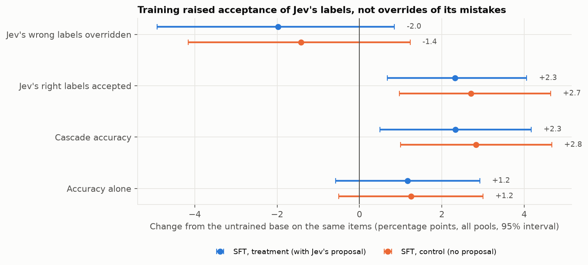
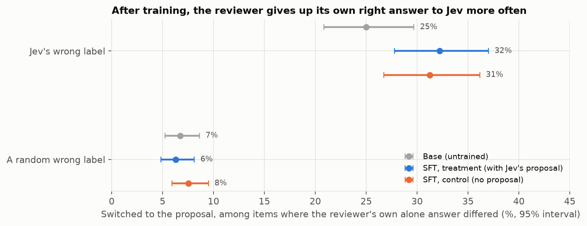

# E.106: Supervised fine-tuning of the reviewer (Part 2's first training run)

**Status:** done 2026-11-04 (`e106-v1-2026-11-04`; about 4.2 GPU hours on one Spot H100, roughly $10–17 of GCP education credits). **Answer: it didn't work.**
- Training the reviewer on its own correct reasoning, with or without Jev's proposal in the prompt, did not make it catch more of Jev's mistakes.
- Instead, both trained reviewers accept Jev's labels a little more often, right or wrong. When shown Jev's wrong label, they give up their own right answer more often.
- Both arms fail all five pre-registered criteria. The arm trained without Jev's proposal behaves the same as the one trained with it.

## The short version, in plain terms

**What we did.**
- **The models.** We fine-tuned gpt-oss-20b, the reviewer, with LoRA on E.105's training data: reasoning traces that reach the gold label, mostly written by the reviewer itself.
- **Two arms.** Both trained on exactly the same items and labels:
  - the **treatment** saw Jev's proposal in each prompt, as the reviewer does in use;
  - the **control** decided every item alone, with no proposal.
- **The test.** We ran the untrained base and both arms on our own GPU, with the same serving software (vLLM), on E.102's frozen test set. A difference between them is therefore training, not serving.

**What we found.**
1. **No more of Jev's mistakes caught.** Both arms override Jev's wrong labels slightly *less* often than the base (−2.0 and −1.4 points). Neither change is clearly different from zero.
2. **More of Jev's right labels accepted.** Both arms do accept more of these (+2.3 and +2.7 points, both clear). That lifts cascade accuracy by about 2.5 points, but only because Jev is usually right. The trained cascades are still no better than Jev alone, so the reviewer adds nothing yet. They are less far below Jev than before, because they now agree with it more.
3. **More switching to Jev's wrong label.** Take the items where the reviewer, deciding alone, gets the right answer and Jev doesn't. When the reviewer is shown Jev's wrong label on one of these:
   - the base switches to it **25%** of the time;
   - the treatment arm **32%** (+7.2 points [+0.9, +13.6]);
   - the control arm **31%** (+6.3 [−0.1, +12.8]).

   On random wrong labels the rate doesn't move: 7%, 6% and 8%. So training made the reviewer more willing to go along with Jev specifically on the hard, plausible cases.
4. **Alone, the reviewer barely changed.** Deciding alone, all three models agree with Jev about equally often (81%, 80%, 81%) and are about equally accurate (70%, 71%, 71%). The change shows up only when a proposal is on the table.
5. **The shared blind spots got slightly worse.** On items the base never gets right alone, the base accepts 92% of Jev's wrong labels. The treatment arm accepts 94% and the control 96%.
6. **Showing Jev's proposal in training made no difference.** The two arms differ by less than a point on the headline rates (overrides of Jev's mistakes −0.6 [−3.0, +2.0], acceptance of its right labels −0.4), and by 1–2 points, within noise, on the rest (blind spots 94% vs. 96%, deference +6.0 vs. +7.5). So the shift isn't something the reviewer learned from seeing Jev's proposals. It comes from fine-tuning on this data at all.
7. **The training loss barely moved.** The logged loss went from 1.04 to 0.99 (treatment) and from 1.01 to 1.02 (control), with epoch averages of 0.98 and 0.975. The treatment's validation loss after a full epoch (0.897) is about what it was after 5 steps in the smoke test (0.899). The model was trained mostly on reasoning it already writes, so little changed.

**An analogy.** We gave the senior doctor a refresher course built from their own best write-ups of cases they had already solved. Afterwards they were a little more inclined to sign off on the junior's diagnosis, whether right or wrong. On the hard cases where they would have caught the junior's mistake on their own, they now let it through slightly more often. The cases they could never solve weren't in the course, because no one could write a correct answer for them.

## The pre-registered criteria

Fixed in [research_docs/14](../../research_docs/14_part2_posttraining.md#pre-registered-success-criteria) and `configs/experiments/e106.yaml` before any training. Changes are from the base, paired on the same items, pooled over the three test pools, with 95% intervals.

| # | Criterion | Treatment (`sft_review`) | Control (`sft_plain`) | Pass |
|---|---|---|---|---|
| 1 | Override-when-wrong rises (interval above 0), and accept-when-right falls by at most 2 points | Override −2.0 [−4.9, +0.9]; accept +2.3 | Override −1.4 [−4.2, +1.2]; accept +2.7 | **No / no** |
| 2 | In every pool, override-when-wrong rises by more than the best E.103 protocol's change (+2.4 / +1.2 / +6.9) | −2.3 / +0.6 / −3.5 | −0.9 / −2.4 / −2.8 | **No / no** |
| 3 | The cascade beats the better single model (Jev), interval above 0 | −1.2 [−3.3, +0.8] (base: −3.5) | −0.7 [−2.8, +1.3] | **No / no** |
| 4 | Criterion 1 holds for each held-out upstream model (Llama, Qwen, Nova) | Override −2.7 / +2.0 / −2.0; accept up 1.6–2.1 | Override −2.2 / +2.4 / +2.2; accept up 2.3–2.7 | **No / no** |
| 5 | Treatment overrides more of Jev's wrong labels than the control (interval above 0) | −0.6 [−3.0, +2.0] | – | **No** |

## What this means for Part 2

1. **This kind of SFT doesn't fix the problem, and the design explains why.**
   - E.105 built its training data by rejection sampling: we kept only the traces that reached the gold label.
   - On the items the reviewer can never solve, the shared blind spots, there's no correct trace to keep, so those items aren't in the training data.
   - What's left mostly teaches the reviewer what it can already do. At best that sharpens existing behavior, and the behavior that got sharper is going along with a plausible proposal.
2. **Showing the proposal in training was not the lever.** The treatment and control arms are indistinguishable. Whatever helps against Jev's errors has to change *what the reviewer believes on the hard items*, not how it reacts to a proposal.
3. **Watch the cascade-accuracy trap.** Cascade accuracy went up while the reviewer got worse at its job. It came closer to Jev by agreeing with Jev. From here on, read cascade accuracy next to override-when-wrong and switching, never alone. This is the same lesson as E.103's blind-first result: one headline number can improve while nothing useful changes.
4. **Options for what to try next:**

   | Option | Why it might help | Cost |
   |---|---|---|
   | **E.107: DPO**, as planned (from the treatment checkpoint) | 58% of its pairs are Jev's mistakes, and each pair contrasts a correct trace with a wrong one on the *same* item. That pushes directly against the wrong answer on the hard items, instead of reinforcing easy ones | ~1 GPU hour |
   | Rebalanced SFT (Jev's mistakes 25% of examples, ~3,900 in all) | Tests whether the mix caused the pull toward acceptance. The control arm's result suggests the mix matters less than we thought | ~2 GPU hours |
   | A different signal for blind spots | Rejection sampling can't make data for items the model never solves. That would need a stronger teacher, or many more samples per hard item | More API spend; design work |
   | Stop Part 2 here | A clear negative result: SFT on self-generated correct traces doesn't fix shared blind spots or deference | – |

## Results

### The base on our GPU vs. the same model on Bedrock

The untrained base, served by vLLM in bf16, was re-measured so that every comparison is on the same stack. It lands within 0–3 points of E.102's Bedrock reviewer. Every Bedrock value but one falls inside the GPU run's 95% interval; the exception is Bedrock's 95.3% on WildGuard prompts, just above the GPU interval's upper bound of 95.0%:

| Pool | Jev's wrong overridden: GPU / Bedrock | Jev's right accepted | Cascade accuracy |
|---|---|---|---|
| Civil Comments | 40.3% / 40.1% | 84.5% / 86.8% | 74.5% / 77.3% |
| WildGuard prompts | 30.5% / 30.5% | 92.8% / 95.3% | 86.3% / 88.3% |
| WildGuard responses | 31.9% / 29.2% | 91.6% / 93.2% | 87.3% / 88.3% |

### Pooled



| Reviewer | Jev's wrong overridden | Jev's right accepted | Cascade accuracy | Accuracy alone | Deference, equal difficulty | Jev's wrong accepted, never right alone |
|---|---|---|---|---|---|---|
| Base | 37.6% (398/1,058) | 89.9% (930/1,034) | 82.7% | 83.3% | +4.8 [−2.1, +11.6] | 92.2% (436/473) |
| Treatment | 35.6% (377/1,058) | 92.3% (954/1,034) | 85.0% | 84.5% | +6.0 [+0.1, +12.8] | 94.1% (445/473) |
| Control | 36.2% (383/1,058) | 92.6% (958/1,034) | 85.5% | 84.6% | +7.5 [+0.7, +14.4] | 96.2% (455/473) |

| Change from the base (paired) | Treatment | Control |
|---|---|---|
| Jev's wrong labels overridden | −2.0 [−4.9, +0.9] | −1.4 [−4.2, +1.2] |
| Jev's right labels accepted | **+2.3 [+0.7, +4.1]** | **+2.7 [+1.0, +4.6]** |
| Cascade accuracy | **+2.3 [+0.5, +4.2]** | **+2.8 [+1.0, +4.7]** |
| Accuracy alone | +1.2 [−0.6, +2.9] | +1.2 [−0.5, +3.0] |

Jev alone is 86.2% accurate on the same 1,200 items. Harmful content let through (WildGuard, Jev said harmless): base 63% (67/107), treatment 66%, control 64%.

### By pool

| Pool | Reviewer | Jev's wrong overridden | Jev's right accepted | Cascade (Jev alone) |
|---|---|---|---|---|
| Civil Comments | Base | 40% (302/750) | 84% | 74% (76%) |
| | Treatment | 38% (285/750) | 87% | 77% |
| | Control | 39% (295/750) | 87% | 78% |
| WildGuard prompts | Base | 30% (50/164) | 93% | 86% (90%) |
| | Treatment | 31% (51/164) | 94% | 88% |
| | Control | 28% (46/164) | 94% | 87% |
| WildGuard responses | Base | 32% (46/144) | 92% | 87% (93%) |
| | Treatment | 28% (41/144) | 94% | 90% |
| | Control | 29% (42/144) | 96% | 91% |

On Civil Comments, both trained cascades now edge past Jev alone (+1.3 and +2.5 points, within their intervals). On WildGuard, both stay below it.

### Where the change happens: switching to a wrong proposal



The items are those where the reviewer's own first alone answer differs from the wrong proposal; on these binary tasks, that means it got the item right alone. The measure is how often it then switches to the proposal.

| Reviewer | Jev's wrong label | Change from base | A random wrong label | Change from base |
|---|---|---|---|---|
| Base | 25.0% (91/364) | – | 6.7% (57/847) | – |
| Treatment | 32.2% (126/391) | **+7.2 [+0.9, +13.6]** | 6.3% (53/844) | −0.5 [−2.8, +1.9] |
| Control | 31.3% (115/368) | +6.3 [−0.1, +12.8] | 7.5% (64/850) | +0.8 [−1.7, +3.4] |

Each model is compared on the items *it* gets right alone, so the item sets differ a little between models, and the intervals come from an unpaired bootstrap. This measure is close to E.102's "deference at equal difficulty", and it moves the same way: +4.8 → +6.0 and +7.5.

### Alone, nothing much changed

On the 3,093 test items with an alone decision from all three models (first sample):

| Reviewer | Agrees with Jev | Accuracy | Accuracy on Jev's mistakes (1,058) | Accuracy where Jev is right (2,035) |
|---|---|---|---|---|
| Base | 80.7% | 70.1% | 34.4% | 88.6% |
| Treatment | 80.3% | 71.3% | 37.0% (gained 114 items, lost 87) | 89.2% |
| Control | 81.1% | 70.6% | 34.8% (gained 109, lost 105) | 89.3% |

The treatment arm is slightly better alone on Jev's mistakes, yet slightly worse at overriding them in review. When it sees Jev's label, it gives back more than it gained.

### Training

| Arm | Steps | Time | Training loss, first → last | Validation loss | Validation token accuracy |
|---|---|---|---|---|---|
| Treatment | 412 | 50 min | 1.04 → 0.99 | 0.897 | 74.5% |
| Control | 412 | 57 min | 1.01 → 1.02 | 0.919 (its own validation set, alone format) | 74.0% |

The two validation losses come from different validation files, one per format, so they aren't directly comparable. Reasoning length barely changed: median output tokens on Jev's wrong labels went from 410 (base) to about 390 (both arms). Every curve is in `data/training_curves.csv`.

## Setup

| | |
|---|---|
| Run | `e106-v1-2026-11-04`. Base evaluated at commit `f43a747`, the trained arms at `bb57a8b`, both clean. The treatment arm was trained at `f43a747` and the control arm at `bb57a8b`. The only change in between is the control arm's batch shape (below). GPU times 03:09–06:31 UTC on 2026-11-05 (19:09–22:31 Pacific, 2026-11-04) |
| Hardware | GCP `a3-highgpu-1g` (1× H100 80GB), Spot, `us-central1-a`, project `cs-329x-510703` (education credits; VM deleted 2026-11-05, adapters kept locally in `checkpoints/`). Deep Learning VM image `common-cu129-ubuntu-2204-nvidia-580`; torch 2.9.1, transformers 4.57.6, TRL 0.23.1, PEFT 0.17.1, vLLM 0.33.0 |
| Base | `openai/gpt-oss-20b`, dequantized from MXFP4 to bf16 and saved (`checkpoints/gpt-oss-20b-base`); served in bf16 like the trained models |
| Training | LoRA r 8, alpha 16, dropout 0, on every linear layer. Learning rate 2e-4, cosine schedule to 10%, 3% warmup, 1 epoch, 16 examples per update, max length 4,096, loss on the reviewer's turn only, seed 106. Prompts are rendered with gpt-oss's chat template at reasoning effort medium |
| Data | `part2_all_v1` from E.105: 6,592 training and 370 validation examples per arm, the same items in both ([E104_E105](../E104_E105/README.md)) |
| Evaluation | E.102's frozen plan, plus 150 wrong decisions per held-out upstream model and pool from E.103. The base decided each item alone 5 times (the difficulty scale), the trained arms once. 32 concurrent requests; 20,130 base reviews and 7,758 per arm; 2 parse failures in total |

**Deviations from the plan, found in the smoke test or during the run:**
- **No expert-weight LoRA.** OpenAI's recipe also adapts the expert weights of layers 7, 15 and 23. With PEFT 0.17 that ran out of memory on one H100: each expert lookup rebuilds a full ~1 GB adapted tensor and keeps it for the backward pass. So LoRA covers the linear layers only, which is less capacity than the recipe.
- **The control arm trained at 2 × 8, not 4 × 4.** At 4 × 4 it ran out of memory in the loss at step 80. Each update is still the same 16 examples in the same order, normalized over the same tokens.
- **Validation runs one example at a time.** gpt-oss evaluates every expert on every token outside training, so the default batch of 8 ran out of memory.

## Caveats

- **One epoch, one learning rate, one seed, rank-8 LoRA without expert weights.** A larger or longer run could behave differently. The flat loss suggests the model changed little, and the measured effects are 2–7 points.
- **The switching measure compares slightly different item sets** for each model (the items it gets right alone), with unpaired intervals. Its direction matches the paired deference measure and the accept-when-right change.
- **The Civil Comments ceiling from E.104–E.105 still applies.** Some of Jev's "mistakes" there are doubtful gold labels that no reasoning-based training will flip.
- **GPU cost is estimated** from uptime and the Spot rate. The education billing account shows the actual charge 12–24 hours later.

## Reproduce

On the GPU machine (runbook: [research_docs/14](../../research_docs/14_part2_posttraining.md#runbook)):

```
scripts/run_e106.sh e106-v1-2026-11-04     # save base, evaluate it, SFT + merge both arms, evaluate both (resumable)
```

Then copy `results/runs/e106-v1-2026-11-04/` back, with the pipeline and vLLM logs in its `logs/` folder, and run:

```
uv run --group analysis python research_analyses/E106/make_figures.py
```
