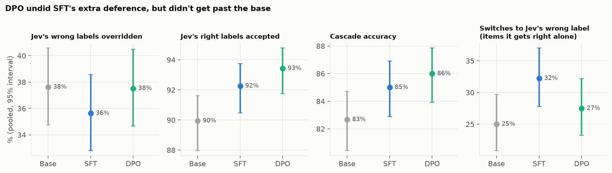

# E.107: DPO on the reviewer's own right vs. wrong reasoning

**Status:** done 2026-11-05. It was evaluated inside E.106's run (`e106-v1-2026-11-04`, reviewer `dpo_review`) and used about 1.2 GPU hours on the Spot H100, roughly $3–5 of credits. **Answer: it didn't work either.**
- DPO undid most of the extra deference that E.106's SFT had added, bringing the reviewer back to the untrained base's level.
- It got no further: it catches no more of Jev's mistakes than the base, and the shared blind spots don't move.
- It fails all five pre-registered criteria.

## The short version, in plain terms

**What we did.** We started from E.106's SFT treatment model and trained it with DPO (direct preference optimization).
- **The data:** 1,019 pairs from E.105. Each pair is two of the reviewer's own answers to the same prompt, one reaching the gold label (preferred) and one not (rejected).
- **The mix:** 58% of the pairs are items Jev got wrong. So unlike SFT, DPO targets the hard items directly, and it pushes *against* the wrong answer instead of only rewarding the right one.
- **The evaluation:** exactly as in E.106, against the same base, on the same items and serving setup.

**What we found.**
1. **Back to the base, not past it.** DPO overrides Jev's wrong labels 37.5% of the time:
   - the base: 37.6%;
   - its SFT starting point: 35.6%.

   Compared with its starting point, that's +1.9 points [−0.9, +4.6]. It recovered what SFT lost, but no more.
2. **The extra deference from SFT mostly went away.** On items the reviewer gets right alone, it switches to Jev's wrong label 27% of the time: the base 25%, the SFT treatment 32%. On random wrong labels it stays at 6%.
3. **It accepts Jev's right labels more** (+3.5 points [+1.8, +5.1] over the base). That brings the cascade level with Jev alone (−0.2 points [−2.2, +1.7]), but not above it. The reviewer still adds nothing that Jev doesn't already get right.
4. **The shared blind spots don't move.** On items the base never gets right alone, it accepts 93% of Jev's wrong labels: the base 92%, SFT 94%.
5. **Some movement on WildGuard, none on Civil Comments.** Overrides of Jev's mistakes rose 2.4 points on WildGuard prompts and 3.5 on responses (both inside their intervals), and fell 1.3 on Civil Comments. More harmful prompts that Jev called harmless got through: 73% (44/60), against the base's 63% (38/60).
6. **DPO barely learned its own objective.**
   - Its training loss stayed at about 0.69, which is ln 2: the value of a model with no preference.
   - On the 64 held-out pairs, it rated the right answer above the wrong one 61% of the time; 50% is chance.
   - The two answers in a pair are long (about 650 log-likelihood units each) and nearly the same, differing in a few reasoning steps and the verdict. One pass over 1,019 pairs with a small adapter doesn't separate them.

**An analogy.** After the refresher course (E.106) made the senior doctor a bit more inclined to sign off on the junior's diagnoses, we showed them pairs of their own past write-ups on the same case: one that got it right, one that didn't. That took away most of the new habit of signing off. But on the cases they never get right, there was no good write-up to show them, so those stayed the same.

## The pre-registered criteria

The rules are the same as E.106's ([research_docs/14](../../research_docs/14_part2_posttraining.md#pre-registered-success-criteria)). Changes are paired with the base on the same items, pooled, with 95% intervals.

| # | Criterion | DPO | Pass |
|---|---|---|---|
| 1 | Override-when-wrong rises (interval above 0), and accept-when-right falls by at most 2 points | Override −0.1 [−3.1, +2.6]; accept +3.5 | **No** |
| 2 | In every pool, override-when-wrong rises by more than the best E.103 protocol (+2.4 / +1.2 / +6.9) | −1.3 / **+2.4** / +3.5 | **No** (passes on prompts only) |
| 3 | The cascade beats the better single model (Jev), interval above 0 | −0.2 [−2.2, +1.7] | **No** |
| 4 | Criterion 1 holds for each held-out upstream model (Llama, Qwen, Nova) | Override −0.4 / +3.8 / +3.1, none clear of 0; accept up 3.2–3.8 | **No** |
| 5 | Overrides more of Jev's wrong labels than the SFT control arm (interval above 0) | +1.3 [−1.2, +3.9] | **No** |

## What this means for Part 2

1. **Neither SFT nor DPO teaches the reviewer to catch Jev's mistakes.** At best, DPO cancels the side effect SFT introduced.
2. **Both share one limit, built into how the data is made.**
   - SFT needs a correct trace from the model, and DPO needs a correct trace paired with a wrong one.
   - On the shared blind spots, the items the reviewer never gets right, neither kind of data exists, so both methods leave those items untouched.
   - E.105 found these are about a third of Jev's mistakes. On Civil Comments, many are doubtful gold labels.
3. **The DPO signal here is also weak.** Its loss never left chance. A larger run might do more on the items the reviewer sometimes solves: more epochs, a higher rank, the expert weights, or a loss on the final answer only. That's tuning, though. It still can't reach the items the reviewer never solves.
4. **RL (GRPO, rewarding the gold label) has the same limit.** An item the reviewer never solves earns no reward, so there's nothing to learn from. Making progress on the blind spots means a training signal that doesn't depend on the reviewer already being able to get there. That's a new strategy, not a next run: see the Part 2 options in [E106](../E106/README.md#what-this-means-for-part-2).

## Results



### Pooled

| Reviewer | Jev's wrong overridden | Jev's right accepted | Cascade accuracy (Jev alone 86.2%) | Accuracy alone | Switches to Jev's wrong label | Jev's wrong accepted, never right alone |
|---|---|---|---|---|---|---|
| Base | 37.6% (398/1,058) | 89.9% (930/1,034) | 82.7% | 83.3% | 25.0% (91/364) | 92.2% (436/473) |
| SFT treatment (DPO's start) | 35.6% (377/1,058) | 92.3% (954/1,034) | 85.0% | 84.5% | 32.2% (126/391) | 94.1% (445/473) |
| SFT control | 36.2% (383/1,058) | 92.6% (958/1,034) | 85.5% | 84.6% | 31.3% (115/368) | 96.2% (455/473) |
| **DPO** | **37.5% (397/1,058)** | **93.4% (966/1,034)** | **86.0%** | **84.8%** | **27.5% (105/382)** | **93.2% (441/473)** |

| DPO compared with (paired) | Jev's wrong overridden | Jev's right accepted | Cascade accuracy |
|---|---|---|---|
| The base | −0.1 [−3.1, +2.6] | **+3.5 [+1.8, +5.1]** | **+3.3 [+1.8, +5.2]** |
| Its SFT starting point | +1.9 [−0.9, +4.6] | +1.2 [−0.4, +2.7] | – |
| The SFT control | +1.3 [−1.2, +3.9] | +0.8 [−0.8, +2.2] | – |

Switching (items the reviewer gets right alone, unpaired bootstrap against the base): DPO +2.5 points [−3.8, +8.6], against SFT treatment's +7.2 [+0.9, +13.6]. On random wrong labels: 6.2%, against the base's 6.7%. Deference at equal difficulty: +7.8 [+1.6, +13.7], against the base's +4.8. That measure and the switching rate move differently here, and both intervals are wide.

### By pool

| Pool | Jev's wrong overridden: base → DPO | Jev's right accepted | Cascade minus Jev alone | Harmful let through |
|---|---|---|---|---|
| Civil Comments | 40.3% → 38.9% (292/750) | 84.5% → 88.8% | −1.3 → +1.5 | – |
| WildGuard prompts | 30.5% → 32.9% (54/164) | 92.8% → 95.6% | −4.0 → −1.3 | 63% → 73% (44/60) |
| WildGuard responses | 31.9% → 35.4% (51/144) | 91.6% → 95.1% | −5.3 → −1.3 | 62% → 66% (31/47) |

Alone, DPO is like the others: it agrees with Jev on 80.8% of items, is 71.3% accurate, and is 36.1% accurate on Jev's mistakes (base 34.4%).

### Training

| | Loss | Rated the right answer higher | Reward margin | Gradient norm |
|---|---|---|---|---|
| First log (update 10) | 0.692 | 41.9% | +0.008 | 11.6 |
| Last log (update 60) | 0.713 | 51.3% | −0.009 | 10.2 |
| Validation (64 pairs) | 0.670 | 60.9% (39/64) | +0.077 | – |

64 updates in 32 minutes. The gradient norms show the adapter did train. A "no inputs require grad" warning in the log comes from the reference model's forward pass and is harmless. Every logged step is in `data/dpo_training.csv`.

## Setup

| | |
|---|---|
| Run | Evaluated in `e106-v1-2026-11-04` at commit `ea63800` (clean); DPO 07:45–08:17 UTC, evaluation 08:18–08:38 UTC, 2026-11-05 |
| Starting point | `checkpoints/gpt-oss-20b-sft-review-merged` (E.106's SFT treatment). A fresh LoRA adapter, with the reference model being that checkpoint with the adapter off |
| Data | `part2_all_v1/dpo_review`: 1,019 training pairs (591 Jev wrong, 428 Jev right) and 64 validation pairs, all on-policy pairs of gpt-oss-20b's own traces from E.105 |
| Settings | LoRA r 8, alpha 16, linear layers only (as E.106). β 0.1, learning rate 5e-5 with 10% warmup, 1 epoch, 1 pair × 16 accumulation steps, max length 4,096, seed 107 |
| Hardware | The same GCP Spot H100 VM as E.106 |
| Evaluation | As E.106: 7,758 reviews, 0 parse failures. Compared with E.106's base and SFT arms in the same run |

**Changed from the plan before the run:**
- **Learning rate 5e-5, not 5e-6.** One epoch is only 64 updates, and E.106's SFT barely moved at 2e-4. The change was decided with the user before E.107 ran (2026-11-05); the criteria are unchanged.
- **1 pair × 16, not 2 × 8,** for memory: each pair is two sequences, and the SFT control had run out of memory at four. The updates are the same 16 pairs.

## Caveats

- **One configuration, one seed,** and DPO's own loss barely moved. This shows that DPO at this scale doesn't work. It doesn't show that DPO can't.
- **DPO started from the SFT treatment model, as planned.** Starting from the base might have landed differently. But SFT barely changed the model alone, and the pairs come from the base's own traces.
- **The per-pool differences are small** (2–4 points, on 144–750 items), and all their intervals include zero.
- **The cost is estimated** from uptime: 1 h 13 min, including about 17 minutes the VM sat idle after the run finished.

## Reproduce

On the GPU machine, after E.106 (runbook: [research_docs/14](../../research_docs/14_part2_posttraining.md#runbook)):

```
scripts/run_e107.sh e106-v1-2026-11-04     # DPO from the SFT treatment, merge, evaluate (resumable)
```

Then copy `results/runs/e106-v1-2026-11-04/` back, with `logs/e107.log`, and run:

```
uv run --group analysis python research_analyses/E107/make_figures.py
```
