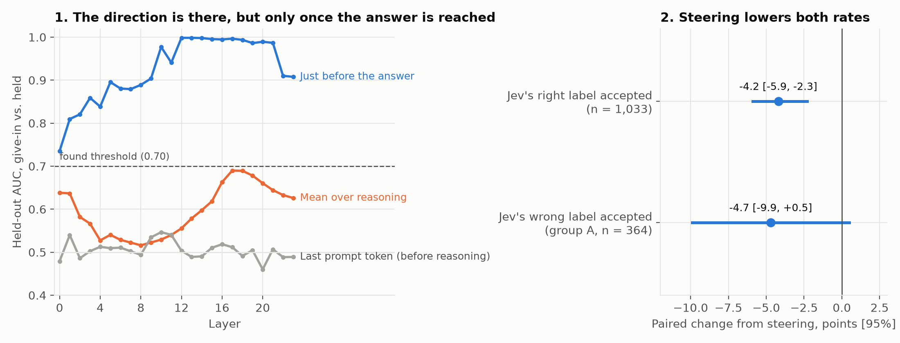

# E.110: activation steering on the base reviewer (base steps)

**Status (2026-11-23): measurements 1 and 2 ran on one Spot H100.** The direction is **found but not causal**. A "give in to Jev" direction is there in the activations, but only just before the answer. Removing it makes the reviewer accept fewer labels of every kind, not fewer of Jev's wrong ones in particular. Measurement 3, whether training removed it, wasn't run. The run is `results/runs/e110-v1-2026-11-22`, and its report is copied to [data/report.md](data/report.md).

Design: [research_docs/15 § E.110](../../research_docs/15_part2_round2.md#e110-activation-steering-interpretability). The thresholds, the α rule, the items and the seed were all fixed in the build on 2026-11-22, before any GPU work.

## 1. Is it there? Found, but late

Regenerate with `uv run --group analysis python research_analyses/E110/make_figures.py`.

The base model replays the existing review traces from E.105, on training-pool items only. The direction at each layer is the paired mean of give-in minus held activations, fit on 353 items and tested on 98 held-out items (352 traces).

| Position | Best held-out AUC | Where |
|---|---|---|
| Last token before the final answer (main position) | **0.998** | layer 12; above 0.97 from layer 10 on |
| Mean over reasoning tokens | 0.69 | layer 17 |
| Last prompt token, before any reasoning | 0.55 | chance at every layer (0.46–0.55) |

- Found by the rule fixed beforehand (AUC ≥ 0.70 at the main position).
- **The signal appears only after the reasoning.** Nothing at the last prompt token predicts whether the reviewer will give in, so giving in isn't decided before it thinks. Just before the answer, the direction mostly encodes which label is about to be written. That is a readout of a decision the reasoning has already made.
- A logistic probe reaches AUC ≥ 0.99 at every layer from the main position, 0.95–1.00 from the reasoning mean, and only 0.46–0.57 from the last prompt token. That fits the reading above: the upcoming answer is easy to decode once the reasoning exists.

## α, chosen on held-out training items

| α (× the direction's norm), layers 11–13 | Jev's wrong label accepted | Jev's right label accepted | Reviews hitting the 4,352-token limit |
|---|---|---|---|
| 0 | 59% | 95% | 0 / 281 |
| 0.5 | 51% | 87% | 0 |
| 1 | 50% | 91% | 1 |
| 2 | 44% | 79% | 11 |
| 4 | 38% | 42% | 108 / 207 |

No α kept accepting Jev's right labels within 2 points. By the rule, α = 0.5 was frozen and flagged as not admissible. At α = 4 the model breaks down.

## 2. Is it causal? No

Test set: group A (364 items, Jev's wrong label, which the reviewer solves alone) and the Jev-right subsample (1,034 items). Steering and the unsteered baseline both ran in the same transformers stack.

| Paired change, unsteered → steered (α = 0.5) | Change | 95% interval |
|---|---|---|
| Jev's wrong label accepted (group A) | 27% → 23%, **−4.7 points** | [−9.9, +0.5] |
| Jev's right label accepted | 92% → 88%, **−4.2 points** | [−5.9, −2.3] |

- **Not causal by the rule fixed beforehand.** The drop in giving in has an interval that crosses 0, and accepting Jev's right labels falls by more than the 2-point limit.
- **The effect is not specific to deference.** The wrong-label and right-label rates fall by about the same amount: the steered reviewer agrees with *any* proposal a little less. Group A's 4.7-point fall is about what you'd expect from a general shift toward disagreeing, with no extra effect on Jev's mistakes. By comparison, the +9-point ceiling on group A would need giving in to fall to 0.
- **Controls:** the random direction finished 70 group-A and 90 Jev-right items before I stopped the run. That is too few to tell anything (its intervals span ±10 points). The "proposal present" direction didn't run. The controls exist to show that a positive effect is specific; with no specific effect to check, they weren't worth the rest of the budget. Finished batches are kept, so they can resume later.
- **The replay matches vLLM:** the unsteered transformers pass accepts 27% / 92%, against the base's E.106 vLLM run at 25% / 90% on the same items.

## What it means

- Steering gives the same answer as E.106–E.108 from a different angle. The reviewer's giving in to Jev is not a separate switch that can be turned off without touching its judgment. It is decided inside the reasoning, item by item, and the only lever the activations offer is a general bias toward agreeing or disagreeing. Pushing that lever trades right labels accepted for wrong labels caught, the same trade the round-1 prompt and training variants made.
- Measurement 3 (did E.108's training remove the direction?) was not run. With E.108 having changed no behavior, and the direction being a readout, it isn't expected to be informative. It needs only the merged E.108 models and about 15 minutes of GPU time, if wanted.

## Run, cost and lessons

- 2026-11-23, Spot a3-highgpu-1g in us-central1-a, at commit eaedd0b plus the batching fix below.
- **Timeline (UTC):** start 18:07; capture and directions by 18:23; alpha selection 18:23–21:03; unsteered pass 21:03–21:57; steered pass 21:57–23:11; random control from 23:11 until I stopped it at 23:15. Then a 10-minute restart to write the report and copy results back.
- **Machine time:** about 5.3 hours, roughly **$35** at $6.60 an hour. That's under the user's raised $40 cap, but about 35% over the plan's $26 upper estimate; the user was warned at 18:26.
- **Fixes:**
  - **Out of GPU memory at prefill:** 16 prompts of about 2,000 tokens each, through gpt-oss's all-experts transformers path, needed about 11 GB more than was free. Generation batches are now capped at 8,192 prompt tokens as well as 16 prompts (`GEN_TOKEN_BUDGET`, `_gen_batches` in `sysone.interp.steering`). The machine powered itself off on the failure within the minute, as designed.
  - **The machine shut itself down every time,** at the end, on failure and on the cost guard, which ran on the machine. The laptop slept twice for over an hour without consequence.
  - **`pkill -f <script>` from an SSH command whose own text contains the script name kills that SSH session** (again, as in E.108). Stop runs by explicit PID.
- **Reproduce:** `scripts/run_e110.sh e110-v1-2026-11-22` on the GPU, as in the runbook, then `uv run --group train python -m sysone.interp.steering report --run-id e110-v1-2026-11-22`. The driver and guard used are saved in the run folder (`go_e110.sh`, `guard.sh`, `e110.log`).
