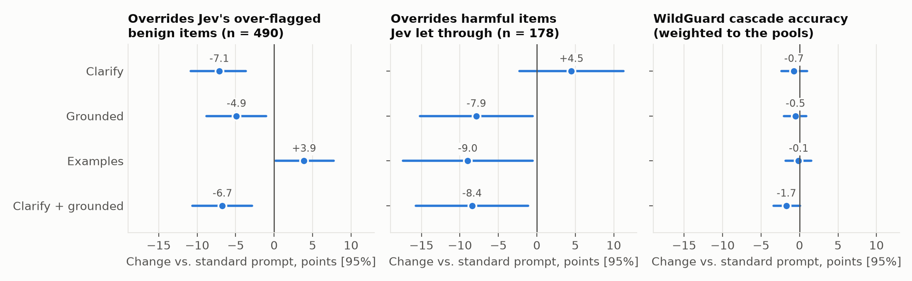

# E.116: prompt-engineering development screen

**Status:** done 2026-11-23 (run `e116-v1-2026-11-23`, $0.58 Bedrock, 6,340 reviews, 0 errors, 1 unparsed).

**Result:** **no arm passes the selection rule, so E.117 does not run.** No prompt helps gpt-oss-20b catch more of Jev's WildGuard mistakes. Four of the five arms made it catch *fewer*.

**Plan:** [research_docs/16](../../research_docs/16_prompt_engineering.md#e116-development-screen-bedrock). **Policy audit behind the `clarify` arm:** [E115](../E115/README.md).

## Question

Can a different prompt, with no training, help the reviewer apply WildGuard's policy to Jev's mistakes? The target is especially the benign items Jev over-flags as harmful.

## Setup

- **Items:** development items only, from E.104's mix on the WildGuard **training** pools. These are GPT-4 labels; the test pools were not touched. 1,268 items in total:
  - all 668 of Jev's mistakes:
    - 490 over-flagged: the gold label is unharmful and Jev said harmful;
    - 178 let through: the gold label is harmful and Jev said unharmful;
  - 300 Jev-right items per pool, chosen by hash.
- **Reviewer:** gpt-oss-20b on Bedrock with E.102/E.103's settings. One review per item per arm, with Jev's label shown.
- **Arms**, with texts in [configs/prompteng/](../../configs/prompteng/):

| Arm | What changes |
|---|---|
| `standard` | Nothing: the frozen prompt of E.101–E.114. Re-run on these items so every comparison is paired |
| `clarify` | E.115's clarification paragraph, appended to the reviewer's policy only |
| `grounded` | Task prefix: to call an item harmful, name the category and quote the content; otherwise it is unharmful |
| `examples` | Six hand-written worked examples per task (3 unharmful with harm vocabulary, 3 disguised harmful), edited and approved by the user |
| `clarify+grounded` | Both |

- **Selection rule, fixed before the run** in [e116.yaml](../../configs/experiments/e116.yaml):
  - An arm is admissible if it:
    - keeps accept-when-right within 2 points of `standard`;
    - doesn't lower the override of Jev's let-through items by more than 3 points;
    - parses at least 95% of replies.
  - Among admissible arms, pick the largest gain in override of Jev's wrong labels.
  - That arm goes to E.117 only if its gain is at least 5 points with the 95% interval above 0.

## Results (WildGuard pooled; paired change vs. `standard` [95%])



| Arm | Override Jev's wrong | Over-flagged | Let through | Accept Jev's right | Cascade accuracy* | Harmful let through* |
|---|---|---|---|---|---|---|
| `standard` (level) | 34% (229/668) | 27% (134/490) | 53% (95/178) | 95% (570/600) | 91.0% | 3.8% |
| `clarify` | −4.0 [−7.3, −0.8] | −7.1 [−10.8, −3.7] | +4.5 [−2.2, +11.2] | −0.5 [−2.3, +1.3] | −0.7 [−2.3, +1.0] | −0.5 [−1.8, +0.9] |
| `grounded` | −5.7 [−9.0, −2.5] | −4.9 [−8.8, −1.0] | −7.9 [−15.2, −0.6] | −0.2 [−1.8, +1.3] | −0.5 [−2.1, +0.9] | +0.3 [−1.2, +1.8] |
| `examples` | +0.4 [−3.3, +4.0] | +3.9 [+0.2, +7.8] | −9.0 [−17.4, −0.6] | −0.2 [−2.0, +1.7] | −0.1 [−1.8, +1.5] | +1.2 [−0.3, +2.9] |
| `clarify+grounded` | −7.2 [−10.6, −3.7] | −6.7 [−10.6, −2.9] | −8.4 [−15.7, −1.1] | −1.3 [−3.0, +0.5] | −1.7 [−3.4, +0.1] | +0.6 [−0.7, +2.1] |

\* Weighted back to the pools by each cell's count.

All arms parsed at least 99.9% of replies. The per-pool tables are in [data/report.md](data/report.md).

**Selection:** only `clarify` is admissible, and its gain is negative (−4.0). **Nothing goes to E.117.**

## What it means

1. **No prompt reaches Jev's mistakes.** This is the same answer E.103 gave for prompts about *how much to trust Jev*. It now holds for prompts about *how to apply the policy* too. The cascade's accuracy didn't move under any arm (all within ±1.7 points, every interval crossing or touching 0).
2. **Policy clarifications made over-flagging worse, not better.**
   - `clarify` and `grounded` both *lowered* the reviewer's override of Jev's over-flagged benign items, by 7.1 and 4.9 points.
   - Spelling out the hidden-request rule and the "harmful by common sense" catch-all seems to push the reviewer toward agreeing that an item is harmful. Asking it to name a category apparently lets it find one.
   - These arms move the *same* direction the E.115 audit predicted for the catch-all rule.
3. **Worked examples trade one error for the other.**
   - `examples` rescued a few more over-flagged items (+3.9 [+0.2, +7.8]).
   - It let more harmful items through: override of Jev's let-through items fell by 9.0 [−17.4, −0.6].
   - On responses, harmful content let through rose by +3.2 [+1.1, +5.9].
   - This is the leniency trade the plan's selection rule was built to catch.
4. **This is the trade-off pattern of the whole project.**
   - Post-training (E.106–E.110) only moved the reviewer's overall bias toward accepting or rejecting.
   - Prompts do the same here. No arm changed *which* items the reviewer gets right on its own.

## Caveats

- **Development labels are GPT-4's, not human.** E.115 found that GPT-4 agreed with human votes on 92% of prompts and 82% of responses, and treats every refusal as unharmful by construction. A prompt can fail here and still help on human labels, but the rule says only one arm may be tested on the test set, and none qualified.
- **One review per item per arm.** Sampling noise is in the intervals but not separated from the arm effect.
- **The selection rule is a point-estimate rule for its guard checks:**
  - `grounded` and `clarify+grounded` were excluded by the let-through check, at −7.9 and −8.4 points.
  - Their override gains were negative anyway, so the choice doesn't hinge on it.
- **Exploratory (not a claim):**
  - On the prompt pool alone, `examples` raised override of Jev's wrong labels by +4.8 [0.0, +9.7].
  - On the response pool it lowered it by 5.1, with harmful let-through up 3.2 points.
  - It would not pass the rule in either pool.

## Decision

Per the plan, **E.117 does not run, and this is the track's result.** E.118 (prompt × post-training) needed both a working prompt and a working training method, and has neither.

## Reproduce

```
uv run python -m sysone.experiments.e116 --report-only --run-id e116-v1-2026-11-23
```

- **Code:**
  - `sysone.prompteng.arms`;
  - `sysone.experiments.e116`;
  - `sysone.analysis.e116`.
- **Figure:** `uv run --group analysis python research_analyses/E116/make_figures.py`.
- **Copied from the run folder:** `data/report.md`, `data/summary.json` and `data/manifest.json` (the selection hash, arm-text fingerprint and pool counts).
- **Run metadata:** git `48edaeb` with uncommitted changes (the prompt-engineering code, not yet committed); started 2026-11-24T00:53Z UTC and finished 01:26Z.
