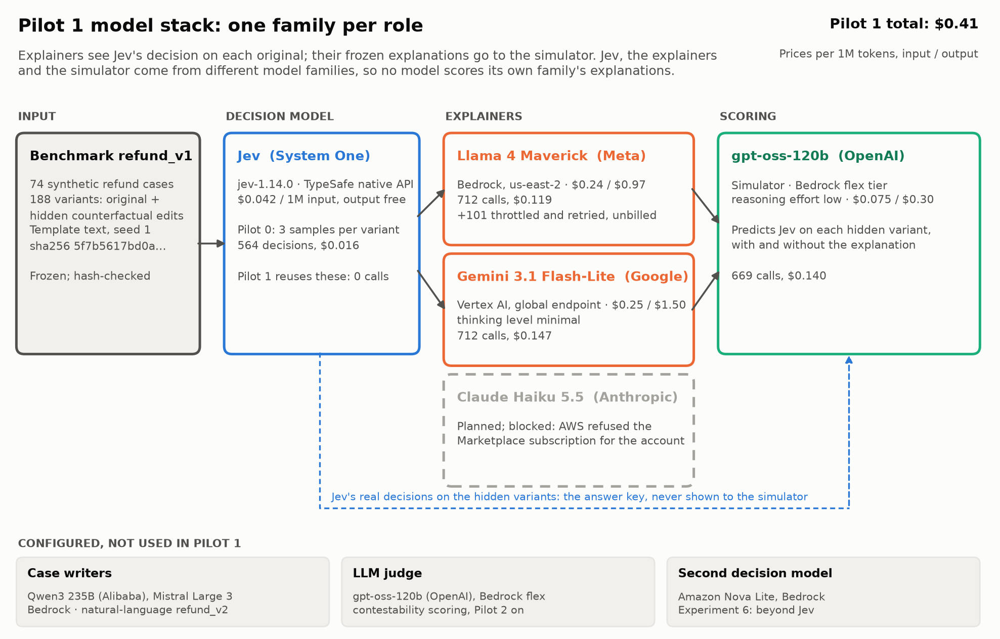
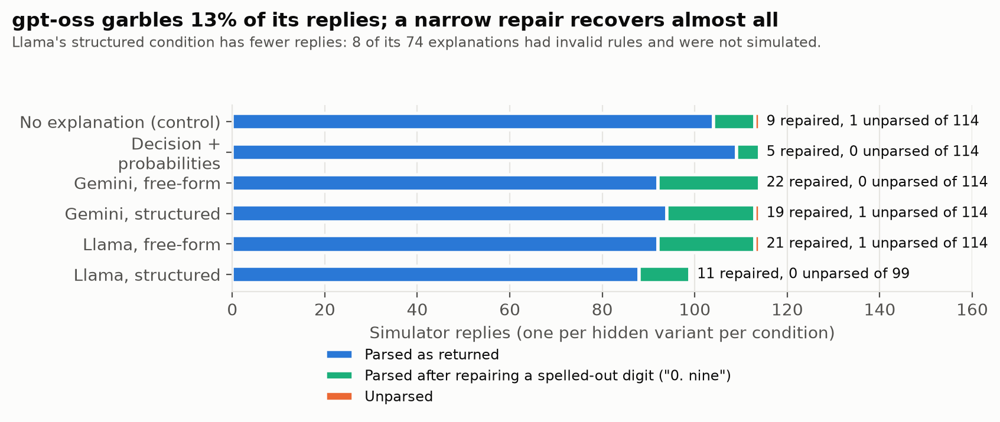
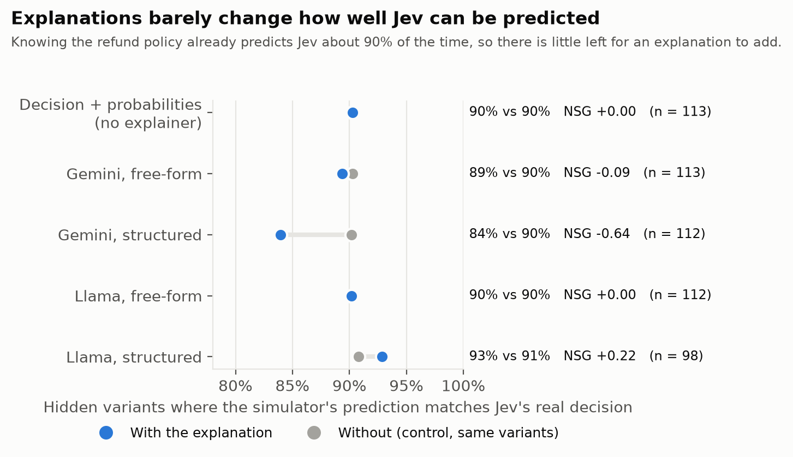
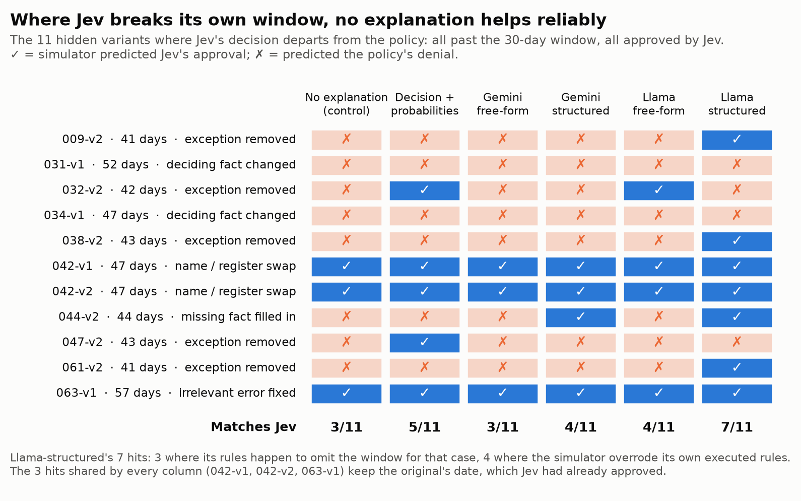
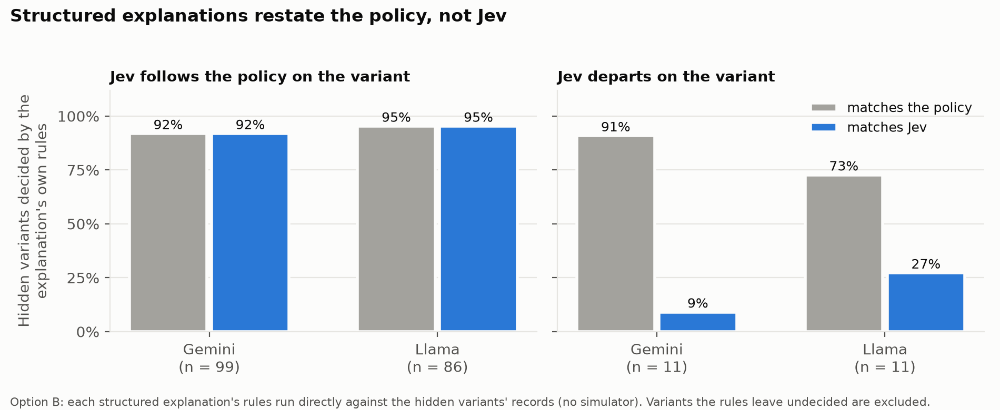
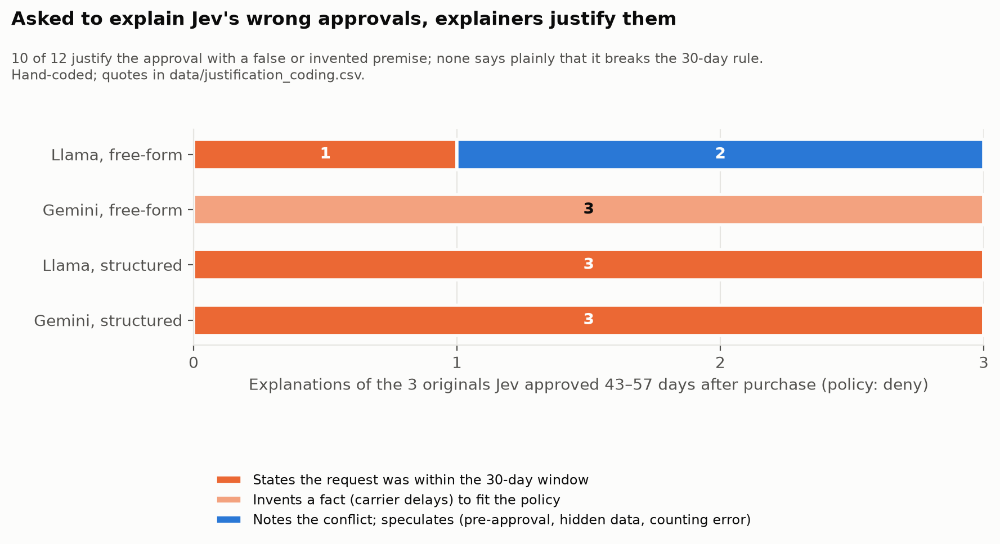
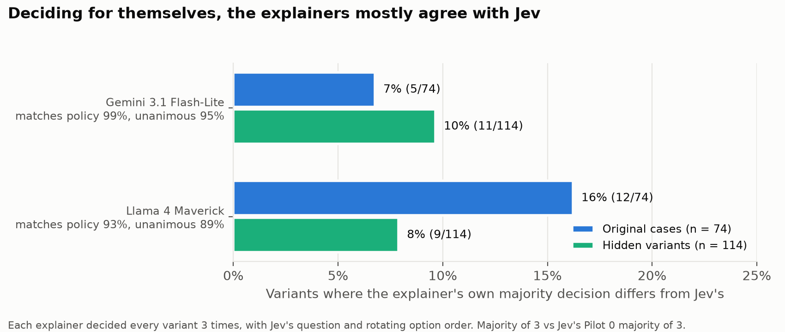
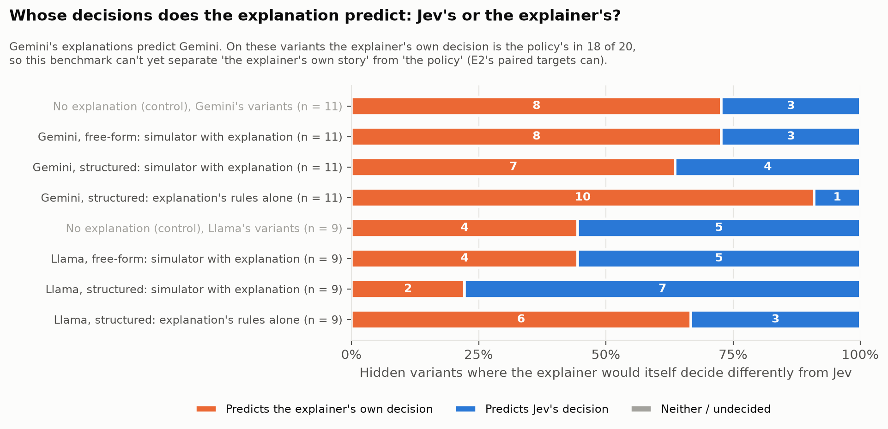
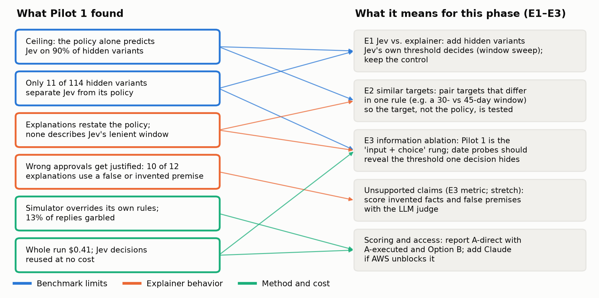

# E1 Pilot 1: Jev vs. explainer (faithfulness)

**Status:** done 2026-10-28 (`pilot1-v1b-2026-10-28`). **Decision: the harness works; the benchmark does not yet test faithfulness.** Before the full Experiment 1, add hidden variants that separate Jev from its policy (a purchase-window sweep), and the LLM judge for contestability.

Pilot 1 asks whether an explanation of one of Jev's decisions helps predict what Jev does on hidden counterfactual edits of the same case. Two LLM explainers see a case, the refund policy and Jev's decision on it, and write a free-form or a structured explanation, which is then frozen. A simulator model predicts Jev's decision on each hidden variant with the explanation and without it (the control). The explainers also decide every variant themselves, so we can see where they and Jev disagree. Design: [research_docs/12](../../research_docs/12_first_experiments_roadmap.md#pilot-1-as-built); it reuses Jev's decisions from [E0](../E0_jev_characterization/README.md).

## Summary

- **Ceiling effect.** Without any explanation, the simulator already predicts Jev on **90%** of hidden variants, because it knows the policy and Jev mostly follows it. Explanations move that by −6 to +2 points (Normalized Simulatability Gain −0.64 to +0.22). The benchmark leaves explanations almost nothing to add.
- **Explanations restate the policy, not Jev.** Run directly against the records, structured explanations' rules agree with the policy, and so miss Jev exactly where it departs from it: Gemini's rules match Jev on 1 of 11 such variants, Llama's on 3 of 11. Gemini's structured explanations make prediction *worse* than no explanation (84% vs 90%).
- **Only 11 of 114 hidden variants separate Jev from its policy**, all of them Jev approving a request 41–57 days after purchase against a 30-day window (its weakness from E0). No condition predicts these reliably (3–7 of 11); the best, Llama-structured, gets there mostly by accident.
- **Explainers justify Jev's wrong approvals.** Asked to explain the 3 originals Jev approved past the window, 10 of 12 explanations justify the approval with a false premise ("within the 30-day window") or an invented fact (carrier delays); none says plainly that it breaks the rule. Deciding on their own, the same two models deny all three.
- **Explanations predict the explainer, not Jev.** Where the explainer would itself decide differently from Jev, Gemini's explanations predict Gemini's decision (8 of 11 free-form; its structured rules 10 of 11). The explainers' own decisions are the policy's in 18 of these 20 cases, so "the explainer's story" and "the policy" can't yet be told apart.
- **The pipeline works and is cheap:** $0.41 for 2,166 calls, every explainer decision parsed, and a narrow, recorded repair recovers 87 simulator replies that gpt-oss garbled.

## This phase's three questions, after Pilot 1

This phase is organized around Experiments 1–3 of [research_docs/05](../../research_docs/05_experiments.md) (renumbered on 2026-10-28 to match the phase plan; E3's probe rungs lead into E4, CAPE under a budget, and E2's name swaps into E7, socially sensitive cues).

| Experiment | Question | What Pilot 1 shows | What it still needs |
|---|---|---|---|
| **E1: Jev vs. explainer** | The explanation is frozen, then tested on hidden counterfactual variants: does it predict Jev's answers or the explainer's own? | Pilot 1 *is* this design, run end to end. Answer so far: **the explainer's own**, which here equals the policy. Gemini's explanations predict Gemini on 7–8 of 11 split variants (rules alone: 10 of 11); Llama's are mixed (4–7 of 9 predict Jev). Overall, explanations add nothing over the no-explanation control (NSG −0.64 to +0.22), because the policy already predicts Jev on 90% of variants. | Hidden variants that Jev's own threshold decides (a purchase-window sweep), so more than 11 variants separate Jev from the policy; the LLM judge for contestability. |
| **E2: Distinguishing similar targets** | With paired synthetic targets that differ in one rule, does the explanation change with the target, or tell the same plausible story? Does it follow the evidence when names or details are swapped? | Jev and its written policy already act as two targets that differ in one rule (the policy's window is 30 days; Jev approves requests up to about 57 days old, per E0). The explanations told **the policy's story** for Jev: structured rules match Jev on 1–3 of the 11 variants where the two differ, and 10 of 12 explanations of Jev's past-window approvals invent a fact or assert a false one to make them fit the 30-day rule. Name swaps change nothing: all 20 name-swap variants are predicted the same with and without an explanation, and Jev ignores names (E0). | Explicit paired targets: the benchmark's policy takes its window as a parameter (`PolicyParams.window_days`), so a 30-day and a 45-day rule-based target can be explained case by case and the explanations compared. Explanations regenerated on name-swapped cases, not just tested on them. |
| **E3: Information ablation** | Same cases, the explainer given more each time: input + choice, + probabilities, + 4 fixed probes, + 4 probes it picks, + 8 probes it picks. Measure fidelity, simulation gain and unsupported claims. | Pilot 1 is the first rung (input + choice): fidelity is at the policy's level and simulation gain is about zero. The "+ probabilities" rung exists only as the simulator-side baseline (Jev's decision and probabilities shown to the simulator, no explainer): 90%, NSG 0, and 5 of 11 on the departures, second only to Llama-structured's 7. **Unsupported claims** already show up: invented carrier delays and false "within 30 days" claims (section 4). | The probe rungs. The departures are exactly what probes should fix: one query at a different purchase date reveals that Jev approves past 30 days, which no single-decision explanation captured. An unsupported-claims score from the LLM judge, checked against the hand coding here. |

## Setup



| | |
|---|---|
| Run | `pilot1-v1b-2026-10-28`, commit `7c85d56` (clean), completed |
| Builds on | `pilot0-v1-2026-10-28` (Jev's decisions: majority of 3 samples per variant, `jev-1.14.0`) |
| Benchmark | `refund_v1`: 74 cases, 188 variants (74 originals, 114 hidden), sha256 `5f7b5617bd0a…` |
| Explainers | Llama 4 Maverick (Meta; Bedrock us-east-2) and Gemini 3.1 Flash-Lite (Google; Vertex AI global, thinking level `minimal`). Claude Haiku 5.5 was planned; AWS refused its Marketplace subscription for this account. |
| Simulator | gpt-oss-120b (OpenAI; Bedrock flex tier, reasoning effort `low`) |
| Conditions | `free_form` and `structured` explanations (one per explainer per case), and `decision_probabilities` (Jev's decision and probabilities, no explainer) |
| Calls and cost | 712 Llama, 712 Gemini, 669 simulator; $0.119 + $0.147 + $0.140 = **$0.41** (projection was $0.31; Vertex counts more input tokens). 101 Llama calls were throttled, retried and not billed. |

Each explainer decided every variant 3 times with Jev's question and rotating option order, then wrote each explanation once, seeing only the original case, the policy and Jev's decision. The simulator saw the policy, the original case, Jev's decision on it, the frozen explanation (or none) and one hidden variant, and returned a predicted decision with probabilities, the rules it used, and whether the explanation covers the variant.

**An earlier attempt**, `pilot1-v1-2026-10-28`, halted and is kept only as a record: Llama reasoned past its 64-token cap on 58% of decisions (fixed with an answer-only system message), and the Gemini API key was on Google's free tier (Gemini moved to Vertex AI).

## Data quality



| | Result |
|---|---|
| Explainer decisions parsed | 1,128 / 1,128 (100%) |
| Explanations parsed | Gemini 148 / 148; Llama free-form 74 / 74, structured 66 / 74 |
| Simulator replies parsed as returned | 579 / 669 (87%) |
| … after repairing a spelled-out digit | 666 / 669 (99.6%): 87 repaired, 3 still unparsed |

gpt-oss-120b sometimes writes a probability as `0. nine` instead of `0.9`, which is invalid JSON (86 times `0. nine`, once `0. eight`). The analysis re-parses saved replies after rewriting only that pattern ([src/sysone/explain/jsonout.py](../../src/sysone/explain/jsonout.py)); the rest of each reply is untouched. **Results with and without the repair agree** (same NSG signs, within 1–3 points; `data/summary_no_repair.json`); the tables below use the repair. Llama's 8 failed structured explanations are real errors: rules the record format can't express, such as `condition = "final sale"`. They weren't simulated, which is why that condition has 99 replies, not 114.

## Results

### 1. Explanations barely change how well Jev can be predicted



| Condition | Scored | With explanation | Control (same variants) | NSG | Covered |
|---|---|---|---|---|---|
| Decision + probabilities | 113 | 90% | 90% | 0.00 | 56% |
| Gemini, free-form | 113 | 89% | 90% | −0.09 | 89% |
| Gemini, structured | 112 | 84% | 90% | −0.64 | 94% |
| Llama, free-form | 112 | 90% | 90% | 0.00 | 82% |
| Llama, structured | 98 | 93% | 91% | +0.22 | 97% |

NSG (Normalized Simulatability Gain) = (with − control) / (1 − control): the share of the control's errors the explanation fixes. "Covered" is how often the simulator said the explanation decides the variant. The control is right on 90% because 103 of 114 hidden variants are decided the way the policy says, and the simulator knows the policy. Explanations do raise the simulator's confidence in Jev's actual decision (mean probability 0.80–0.87 with, 0.79 without), most for Llama-structured.

The simulator mostly follows the explanation when it has one: its stated rules agree with its own prediction 91–97% of the time ("A-direct vs A-executed" in `data/report.md`).

### 2. Where Jev departs from the policy, nothing helps reliably



| Condition | Matches Jev on the 11 departures |
|---|---|
| No explanation (control) | 3 |
| Decision + probabilities | 5 |
| Gemini, free-form | 3 |
| Gemini, structured | 4 |
| Llama, free-form | 4 |
| Llama, structured | 7 |

All 11 are requests 41–57 days after purchase that Jev approves and the 30-day policy denies. The 3 that every condition gets right (042-v1, 042-v2, 063-v1) keep the original's purchase date, which Jev had already approved, so the simulator can copy Jev's decision on the original. Llama-structured's 7 is not evidence that it described Jev's leniency: in 3 its rules happen to leave the window out for that case, and in 4 the simulator predicted approval while its own stated rules said deny. With 11 variants, none of these differences is reliable.

### 3. Structured explanations restate the policy, not Jev



Each structured explanation's own rules, run against the hidden variants' records with no simulator (Option B):

| Explainer | Jev follows the policy: rules match the policy / Jev | Jev departs: rules match the policy / Jev |
|---|---|---|
| Gemini | 92% / 92% (n = 99) | 91% / **9%** (n = 11) |
| Llama | 95% / 95% (n = 86) | 73% / **27%** (n = 11) |

Where Jev follows the policy, the rules can't tell the two apart; where it departs, the rules side with the policy. An explainer that sees one decision has no way to learn that Jev is lenient about the window, so it writes down the policy. Gemini's structured explanations also often leave the window out entirely (52 of 74 have no 30-day condition), which explains part of their 84%.

### 4. Asked to explain Jev's wrong approvals, explainers justify them



Jev approved 3 original cases 43–57 days after purchase (042, 056, 063; the store-harming errors from E0). Both explainers explained each in both conditions: 12 explanations, hand-coded (quotes in `data/justification_coding.csv`):

| | False premise ("within the 30-day window") | Invented fact (carrier delays) | Notes the conflict and speculates |
|---|---|---|---|
| Llama, free-form | 1 | 0 | 2 |
| Gemini, free-form | 0 | 3 | 0 |
| Llama, structured | 3 | 0 | 0 |
| Gemini, structured | 3 | 0 | 0 |

Examples: Gemini, "the system likely accounted for potential carrier delays" (none are documented); Llama, "it still falls within the 30-day limit" (44 days). The two that come closest to flagging the error still hedge: "It's possible that the system … made an error in counting the days." Yet **deciding on their own, both explainers deny all three requests**: they know the policy answer, and write a justification for the opposite one when asked to explain Jev.

This is the stretch goal's behavior (explainers rationalizing a bad decision) showing up unprompted, on only 3 cases with one coder. It needs the judge and more cases before it counts as a finding.

### 5. Deciding for themselves, the explainers mostly agree with Jev



| Explainer | Disagrees with Jev: originals | Hidden variants | Matches the policy | Unanimous across 3 |
|---|---|---|---|---|
| Gemini | 7% (5 / 74) | 10% (11 / 114) | 99% | 95% |
| Llama | 16% (12 / 74) | 8% (9 / 114) | 93% | 89% |

On the originals, the disagreements are mostly the explainers being stricter where Jev is wrong (both deny Jev's 3 wrong approvals) or answering "undetermined" where Jev decides (Llama does this on 5 of the 24 corrupted-record cases). Neither explainer approves any of the 24 corrupted-record cases that the true record would earn: like Jev, they decide on the record they are shown (Llama answers "undetermined" on 5, Gemini on 1).

### 6. Whose decisions does the explanation predict: Jev's or the explainer's?



On the hidden variants where the explainer's own majority decision (from its 3 independent decisions) differs from Jev's:

| | Variants | Simulator with explanation: predicts explainer / Jev | Control: explainer / Jev | Structured rules alone: explainer / Jev |
|---|---|---|---|---|
| Gemini, free-form | 11 | 8 / 3 | 8 / 3 | |
| Gemini, structured | 11 | 7 / 4 | 8 / 3 | 10 / 1 |
| Llama, free-form | 9 | 4 / 5 | 4 / 5 | |
| Llama, structured | 9 | 2 / 7 | 4 / 5 | 6 / 3 |

This is the E1 question in its sharpest form. Gemini's explanations, and especially its rules, describe Gemini's own decisions. Free-form explanations leave the simulator exactly where it was without them. Llama-structured is the only condition that moves toward Jev, and section 2 shows that is mostly the simulator overriding the rules rather than the rules describing Jev. On these variants the explainer's decision is the policy's in 18 of 20 cases, so the result is equally "explanations predict the policy". E2's paired targets are what separate the two.

## What this sets up



| Finding | Changes | How |
|---|---|---|
| Control already at 90%; only 11 of 114 hidden variants separate Jev from its policy | E1 | Add hidden variants that Jev's own threshold decides: a purchase-window sweep (about 25–65 days, net of carrier delay) on cases whose other rules pass, so faithfulness to *Jev* is measurable and not just faithfulness to the policy. Freeze as a new benchmark version. |
| Explanations tell the policy's story; the explainer's decision equals the policy's in 18 of 20 split variants | E2 | Pair rule-based targets that differ in one rule (e.g. `window_days` 30 vs 45) and explain the same cases for each. If the explanations don't change with the target, that is the "same plausible story" failure, measured directly. Regenerate explanations on name-swapped cases. |
| One decision can't reveal Jev's window | E3 | Pilot 1 is the "input + choice" rung. The probe rungs should find the threshold; the 11 departure variants (and the window sweep) are where fidelity should rise with information. |
| 10 of 12 explanations justify wrong approvals with false or invented premises | E3 (unsupported claims); stretch S1–S3 | Rationalization appears without any pressure. Score unsupported claims with the LLM judge on more cases, including the 24 wrong denials, and check the judge against this hand coding. |
| A-direct and A-executed diverge where it matters; NSG swings with tiny changes | Scoring | Always report the control alongside, and report A-direct with A-executed, Option B and the departure subset, never one blended score. |
| Contestability is still unscored | E1 full run | Build the LLM judge (gpt-oss-120b, configured): does the explanation name the corrupted field in the 24 contestable cases? Add Claude Haiku 5.5 as a third explainer if AWS unblocks it. |
| $0.41 for the whole pilot; Jev decisions reused | Budget | Pilot 1's full-scale repeats fit easily; re-estimate E2 with Llama costing about twice Haiku per token. |

## Caveats

- **Small departure set.** 11 variants (all one kind of departure: window leniency) carry the interesting comparisons; differences of 1–4 variants between conditions are noise.
- **One run, one sample per simulation, one simulator.** gpt-oss-120b's own reading of the policy shapes every score, including the control.
- **Hand coding** of the 12 justifications was done by one coder (Claude, reviewed against the full texts); the categories and quotes are in `data/` for checking.
- **Repair.** 87 simulator replies parse only after the spelled-digit repair. Results without it are in `data/summary_no_repair.json` and lead to the same conclusions.
- **Llama, not Claude.** The second explainer is Llama 4 Maverick because Claude was blocked on the AWS account; conclusions about "explainers" cover two models.
- **Template text, one policy family, one Jev version**, as in E0.

## Reproduce

```bash
uv run python -m sysone.experiments.pilot1 --pilot0-run pilot0-v1-2026-10-28 --run-id <id>   # live (AWS + GCP)
uv run python -m sysone.analysis.pilot1 results/runs/<id>                                    # report, with repair
uv run python -m sysone.analysis.pilot1 --no-repair results/runs/<id>                        # without it
uv run --group analysis python research_analyses/E1_pilot1/make_figures.py                   # figures and data/
```

`data/` holds the run's `summary.json` (with repair), `summary_no_repair.json`, `report.md`, every scored simulation (`simulations.csv`), Option B split by departure (`option_b_split.json`), the Jev-or-explainer split (`jev_or_explainer.json`), calls and cost by model (`calls_by_model.csv`) and the justification coding with quotes (`justification_coding.csv`), so these results survive if `results/` is lost.
