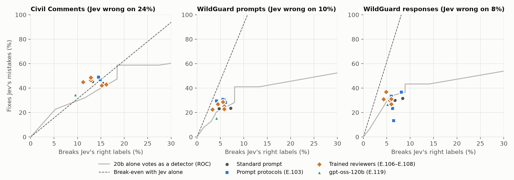

# E.20: a correlation ceiling for the cascade

**Status:** done 2026-11-24. Free: a re-analysis of saved runs, with no API calls. **Plan:** [research_docs/17](../../research_docs/17_second_batch.md#e20-a-correlation-ceiling-for-the-cascade-free). **Rules, fixed before computing:** [e20.yaml](../../configs/experiments/e20.yaml).

**Result:** both rules pass, but the picture differs from the one the plan expected.

1. **The reviewer barely defers. It re-decides.**
   - Fitted on Jev → gpt-oss-20b, the deference parameters are 0 in every pool: the cascade review behaves like one more of its alone answers.
   - Every upstream's cascade with the 20b lands at 82.6–83.1%, whatever that upstream's own accuracy (84.5–86.2%). The cascade's accuracy is set by the reviewer, not by the upstream.
2. **The ceiling is low.** No policy that uses the reviewer's own answers can add more than a few points to Jev:
   - +1.6 [+0.7, +3.2] for the 20b with 5 alone answers per item;
   - +2.8 [+1.5, +4.5] for the 120b.

   These are in-sample bounds, so optimistic. Every observed cascade sits 3–5 points below its ceiling.
3. **Error overlap matters less than expected.** Across 57 pairs of upstream and reviewer, the ceiling correlates only weakly with phi (Spearman −0.27). With a random-error upstream (phi ≈ 0), the 20b's ceiling is still only +2.9.

   What limits the ceiling is that the reviewer is no more accurate than Jev:
   - On WildGuard, Jev is wrong on 8–10% of items. A reviewer has to fix about ten of Jev's mistakes for every right label it breaks.
   - The 20b's own answers don't separate Jev's mistakes from its right labels that well.

## Question

Every intervention (prompts, training, steering, a 6× larger model) left the cascade at or below Jev alone. Can a few numbers predict every cascade result we have, for any upstream model and any reviewer variant? The numbers are:
- how often each model is right alone;
- which items they get wrong together;
- one or two deference parameters.

And what is the most any reviewer could add?

## Method

The tasks are binary, and the reviewer is never told who proposed a label. So its review of "label L shown on item i" is the same whichever upstream proposed L. That means cascades with Llama 4 Maverick, Qwen3-32B, Nova Lite or a random-error upstream can be computed from reviews already saved:
- E.102's `correct_label`, `jev_label` and `matched_label` reviews;
- E.106's `upstream_wrong` reviews.

Coverage is 94–100% of each upstream's items on E.102's subsample (400 per pool), and the coverage is reported per pool.

- **The ceiling.** The reviewer's alone vote share against the upstream's label works as a detector of the upstream's mistakes.
  - The best gain over the upstream alone of any threshold policy on that detector is computed, with thresholds set separately for each proposed label. In-sample, so it is an upper bound.
  - It is computed for every upstream (Jev, Llama, Qwen3-32B, Nova, matched random) against every reviewer with alone answers. That is the 20b on vLLM (E.106) and on Bedrock (E.102), the 120b (E.119), E.106's trained arms, and the other models as one-answer reviewers.
- **The deference model.** On each item, s is the share of the reviewer's alone answers that are right. The final label is right with probability:
  - s + (1 − s) d_r when the right label is shown;
  - s (1 − d_w) when the wrong one is.

  d_w and d_r are fitted per pool, by moments, on Jev → 20b (`base_local`) only. They then predict the cascades of the other four upstreams.
  - **Independence model (the comparison):** the same, with s replaced by the pool's mean alone accuracy, which ignores which items are hard.

## Results



*Each point is a reviewer variant with Jev upstream. Above the dashed line, the cascade would beat Jev alone. The grey curve is what thresholding the 20b's own alone answers can reach.*

- On WildGuard, every variant sits far below break-even, along the 20b's own curve.
- On Civil Comments, a few trained reviewers sit near break-even: +2.4 at best, for the DPO reviewer.

**R1: overlap and deference predict the cascade (pass).**

| Upstream → 20b | Upstream alone | Observed cascade [95%] | Predicted, item-level | Predicted, independence |
|---|---|---|---|---|
| Jev (fitted) | 86.2% | 82.6% [80.5, 84.6] | 83.0% | 82.6% |
| Llama 4 Maverick | 84.5% | 83.0% [80.9, 85.0] | 83.5% ✓ | 81.4% |
| Qwen3-32B | 85.7% | 83.1% [80.9, 85.1] | 83.3% ✓ | 82.2% |
| Nova Lite | 85.6% | 83.1% [81.1, 85.2] | 83.3% ✓ | 81.9% |
| matched random | 86.2% | 82.9% [80.7, 84.9] | 83.0% ✓ | 82.6% |

- **Error:** mean absolute error over the four held-out cascades is 0.3 points for the item-level model and 1.0 for the independence model.
- **Fitted deference:** 0 in every pool. The unclipped estimates are −0.07 to −0.13 for d_w and −0.01 to −0.25 for d_r: on its one review, the vLLM 20b overrides Jev's mistakes slightly *more* often than its alone answers imply.
- **The Bedrock 20b and the 120b show small positive deference:**
  - d_w −0.05 to +0.24 (20b) and 0.05–0.40 (120b), largest on WildGuard, where only 30–39 Jev mistakes are in the subsample;
  - d_r 0–0.15.
- **Jev → 120b:** predicted from the 120b's alone answers with the 20b's deference: 85.1%; observed: 84.9%.

**R2: the ceiling holds (pass), with a wide margin.**

| Reviewer (5 alone answers) | Ceiling over Jev [95%] | Observed cascade − Jev [95%] |
|---|---|---|
| gpt-oss-20b, vLLM (E.106) | +1.6 [+0.7, +3.2] | −3.6 [−5.6, −1.4] |
| gpt-oss-20b, Bedrock (E.102) | +2.2 [+1.3, +4.2] | −1.7 [−3.6, +0.2] |
| E.103's four prompt protocols (E.102's alone answers) | +2.2 | −1.9 to −2.3 |
| gpt-oss-120b (E.119) | +2.8 [+1.5, +4.5] | −1.3 [−3.1, +0.4] |

Against weaker upstreams the ceiling is higher:
- Llama → 20b: +4.8; Nova → 20b: +3.2; the random-error upstream → 20b: +2.9.
- Llama → 120b: +5.9.

The observed cascades are still below their upstreams there: Llama −1.4, Nova −2.5. Full table: [data/report.md](data/report.md).

## What it means

1. **"Deference" was the wrong frame for the cascade's accuracy.**
   - E.102's deference (+7 points at equal difficulty) is real. It compares Jev's wrong labels with random wrong labels.
   - But measured against the reviewer's own answers, its one review adds almost nothing toward the proposed label.
   - So the cascade's accuracy is about the reviewer's alone accuracy on each item. A reviewer that is less accurate than Jev pulls the cascade below Jev, whoever the upstream is.
2. **The interventions moved points along a fixed curve.** Prompts, training and the 120b shift how often the reviewer overrides. None moved the curve of what its own judgment can detect (the figure). This is the quantitative version of "they only moved the lean".
3. **The ceiling is a policy gap, not a capability gap.** Even the reviewers we have could in principle add +1.6 to +2.8 points over Jev, from their own alone answers. The cascade loses because it overrides whenever its single review disagrees.
   - **Better policy:** override only when nearly all of several alone answers disagree, with the threshold chosen separately per label.
   - **Caveat:** the bound is in-sample. Whether any of it survives out of sample is untested; the plan would be to choose thresholds on the training pools (E.105 has 2–4 alone answers per item). It also costs 5 reviewer calls per item.
4. **Overlap sets less of the ceiling than the accuracy gap does.** Even a reviewer whose errors are independent of the upstream's (phi ≈ 0) gains at most about 3 points. Jev is right 86% of the time, so breaking 1% of its right labels costs as much as fixing 6% of its mistakes gains.

## Caveats

- **The ceiling is in-sample** (thresholds chosen on the same items) and so optimistic. It also counts only policies built on the reviewer's alone answers. A policy that also used Jev's confidence could reach higher; E.21 Part A tests the routing version of that.
- **The trained arms have one alone answer per item,** so their ceilings use less information. They are reported but not part of R2.
- **R1 is an easy test once deference is near 0.** The model then reduces to "the cascade is right as often as the reviewer alone, item by item". The independence model's error is only 1.0 point, because the four upstreams have similar accuracy. A sharper test would need an upstream much weaker or stronger than the reviewer.
- **WildGuard has few Jev mistakes in the subsample** (39 and 30), so the per-pool deference fits there are noisy.
- **The 20b is from the vLLM stack** (E.106, `base_local`), as in E.114. The Bedrock 20b (E.102) is reported alongside.

## Reproduce

```
uv run python -m sysone.analysis.e20
uv run --group analysis python research_analyses/E20/make_figures.py
```

- **Code:** `sysone.analysis.e20`.
- **Tests:** `tests/test_e20_e21.py`.
- **Inputs:** runs `e102-v1-2026-11-04`, `e103-v1-2026-11-04`, `e106-v1-2026-11-04` and `e119-v1-2026-11-24`, all read only.
- **Outputs:** `data/summary.json`, `data/report.md`.
